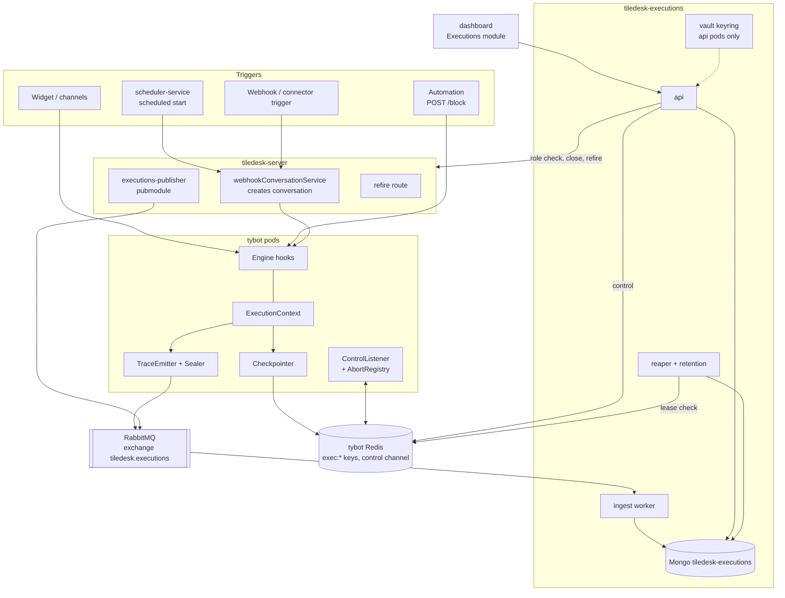
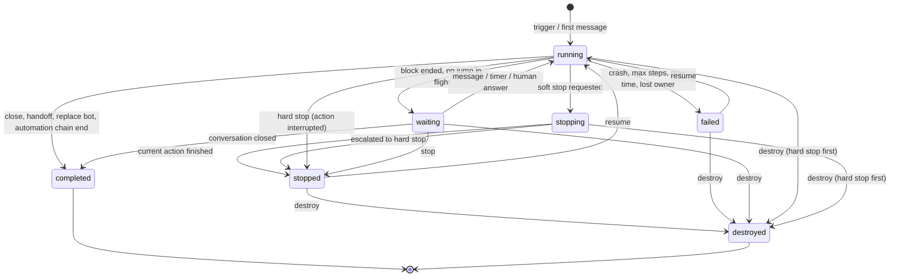
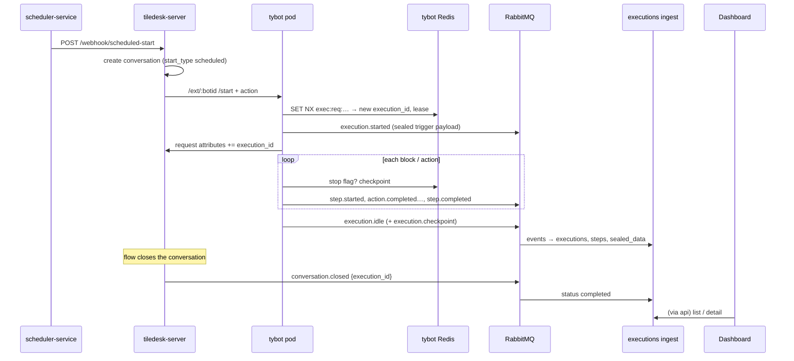
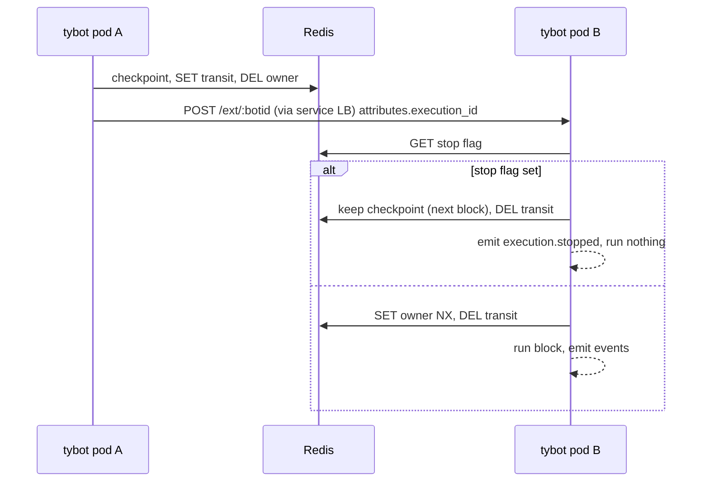
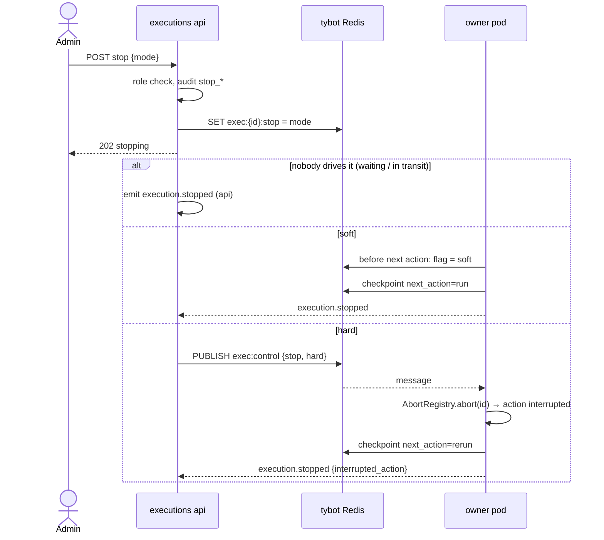
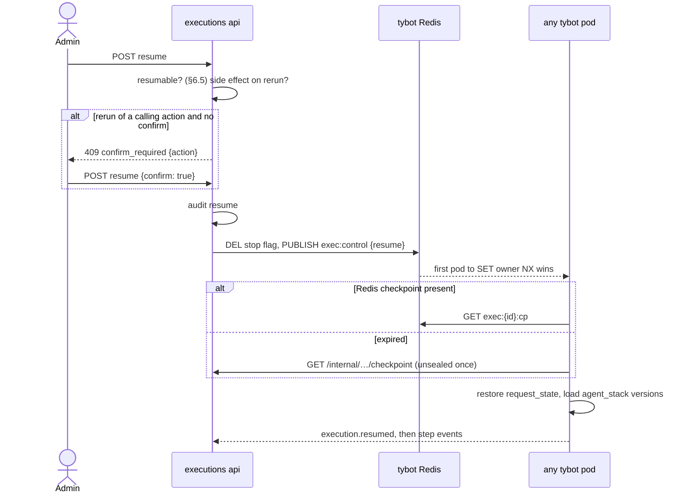
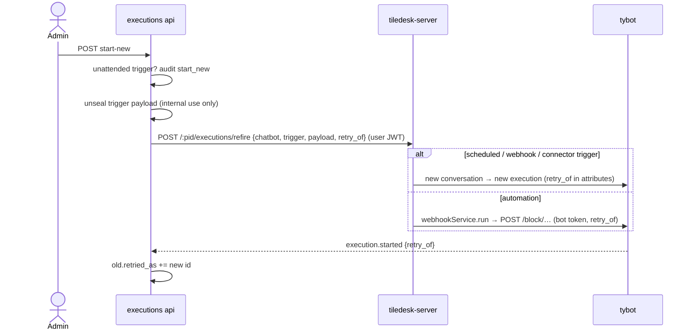
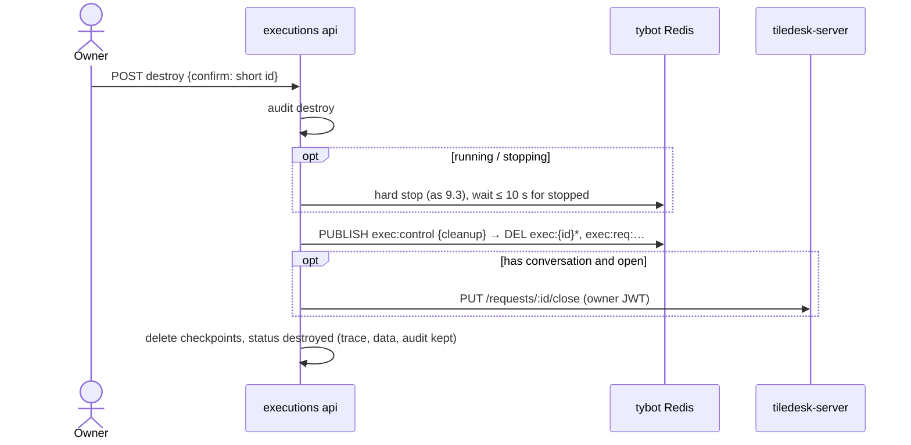
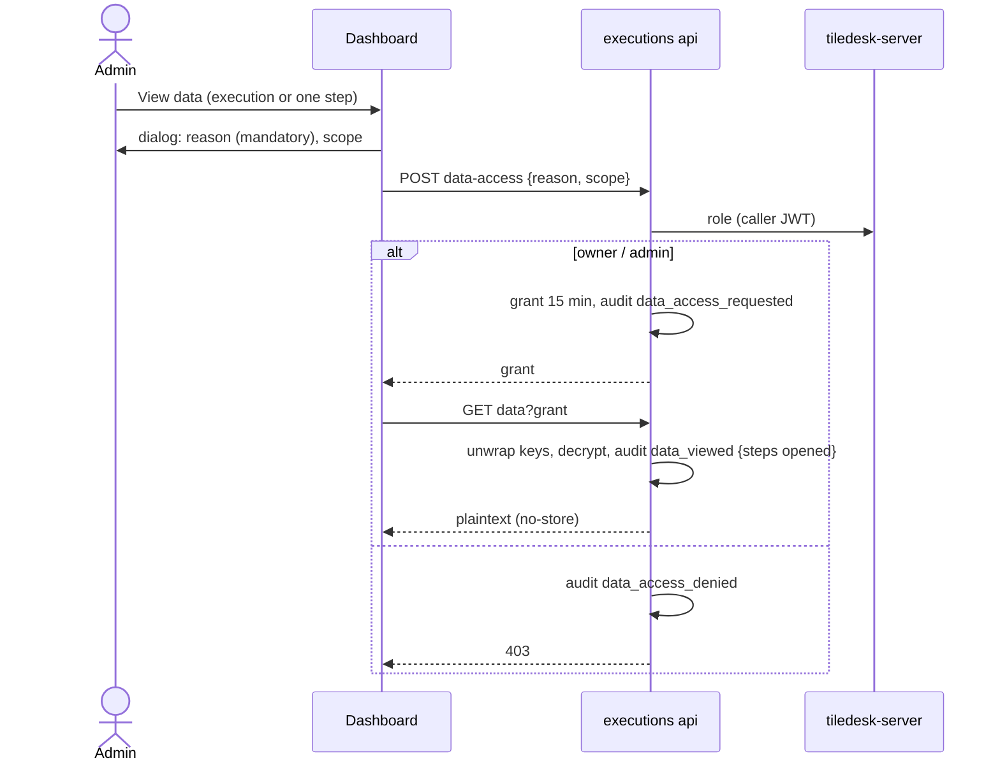

# Agent execution traceability and control — design

**Date:** 2026-11-09
**Status:** draft v2 (deep design), awaiting approval
**Branch:** `feature/execution-traceability` (tiledesk-chatbot, from `origin/main` af406feb 3.0.5)
**Repos touched:** tiledesk-chatbot (tybot), **new** `tiledesk-executions`, tiledesk-server,
tiledesk-dashboard, tiledesk-scheduler-service (small), tiledesk-argo
**UI mockup:** linked from the review message. Section §11 is the authoritative description.

Decisions taken with Nico are marked **[decided]**. Calls I made are marked **[my call]**.
Everything else follows from those two.

---

## Contents

1. Intent
2. Goals, non-goals, anti-goals
3. Constraints
4. Approaches considered
5. Component map
6. Concepts and status model
7. Components in depth
8. Contracts (events, Redis, APIs)
9. Interaction flows
10. Security and governance
11. User interface
12. Performance and reliability
13. Retention
14. Phases and repos
15. Left to the builder

---

## 1. Intent

Agents (chatbots) run today and leave nothing behind. A project owner cannot tell that an agent
ran, what it did, whether it failed or why, and cannot stop, resume or kill it.

This work gives the project a **monitor of agent executions** for three needs **[decided]**:

- **Traceability and governance:** a durable record of every execution: what started it, which
  blocks ran, what outcome each one produced, how it ended.
- **Control:** soft stop, hard stop, resume, start new, destroy.
- **Unattended executions first:** scheduled agents and webhook/automation starts have nobody in
  the chat to notice a problem. The monitor is the only way anyone will know.

### What exists today (and why it is not enough)

| Today | Where | Gap |
|---|---|---|
| Flow logs: free text lines over AMQP (`Logger.js`, topic `apps.tilechat.logs.<request_id>`) | tiledesk-server `FlowLogs`, TTL 5–30 min; dashboard `bots/flow-webhooks-logs`, DS test panel | debug only, unstructured, only when `FLOW_LOGS_ENABLED`, gone in minutes |
| Analytics events (`agent.intent_matched`, `agent.block_executed`, `agent.flow_error`…) | tiledesk-analytics (ClickHouse) | aggregates, no per-execution history, no control |
| Execution state: attributes, step counter, start time, locked intent/action | tybot Redis (`TdCache`), mostly 24 h TTL | not an entity, cannot be listed or controlled, expires |
| Stop | `TiledeskChatbot.checkStep` (max steps / max time) | safety limits only, nobody outside can stop a run |
| Scheduled agent run log | tiledesk-scheduler-service | records only whether the HTTP fire succeeded, not what the flow did |

## 2. Goals, non-goals, anti-goals

**Goals**

1. Every execution is recorded, attended or not, with its trigger, agent and agent version **[decided]**.
2. A block-by-block trace: start/end time, duration, exit taken, outcome
   (`success`, `failure_condition`, `error`, `interrupted`, `skipped`). Failure conditions are tracked like successes **[decided]**.
3. A clear execution status (§6) plus a count of the failure conditions hit.
4. Controls **[decided]**: **soft stop** (applied from the next block/action), **hard stop**
   (interrupts the running operation now), **resume** from where it was interrupted, **start new**
   (a fresh execution, the failed one is not overwritten), **destroy**.
5. Execution **data** (attribute values, request/response bodies, prompts, trigger payload) is
   **sealed**. It is readable only through an explicit, audited **in-depth access request** **[decided]**.
6. Every control action and every data access is in an append-only audit log: who, when, which
   execution, why **[decided]**.

**Non-goals (v1)**

- Aggregate metrics and charts: these stay in tiledesk-analytics.
- Replacing the flow logs (DS test panel, `flow-webhooks-logs`): they keep working. Retiring them is a follow-up.
- Vibe-coder runs in tiledesk-agent-runtime: they already have runs, stop and checkpoints.
- Alerting/notifications on failure (follow-up, §14).
- An approval workflow for data access (prepared, not built, §10.4).

**Anti-goals**: it would be a failure, even if it technically works, if:

- tracing makes conversations noticeably slower (budget §12);
- trace events get lost **silently** (gaps must be visible);
- sensitive values can be seen by anyone without an audit record;
- resume silently repeats a side effect (a POST, an email) without the user being told;
- a stop leaves the execution in an undefined state.

## 3. Constraints

- tybot runs on several pods. Any pod may receive the next message of a conversation, and every
  **block jump is an HTTP post** to `TILEBOT_ENDPOINT/ext/:botid` that can land on another pod.
- The current per-request Redis state expires (24 h). Resume needs its own checkpoint.
- AMQP (RabbitMQ, `@tiledesk/tiledesk-multi-worker` Publisher) is available to tybot and the server.
- Auth: Tiledesk user JWT (`sub: "user"`) plus project roles, checked through tiledesk-server, like
  the scheduler-service console.
- Branching: one feature branch per repo, cut from that repo's default branch, merged separately
  into the default branch and the pre branch (`main` / `main_pre` for tybot). Never pre into default.

## 4. Approaches considered

| | Where the execution record lives | Trade-off |
|---|---|---|
| A | inside tiledesk-server (Mongo), extending the `FlowLogs` AMQP consumer | fastest, auth already there; but every turn of every bot writes into the main DB and loads the server; vault and audit share the business DB |
| **B [decided]** | **new dedicated service `tiledesk-executions`**, own Mongo | isolated volume and scaling, clear governance boundary (vault with its own key and credentials); one more service to run |
| C | extend tiledesk-analytics (ClickHouse) | great for append volume and TTL; poor for mutable status, control and record-level audit; mixes governance with metrics |

## 5. Component map



| Component | Repo | New / changed | Job in one line |
|---|---|---|---|
| Engine hooks, ExecutionContext, TraceEmitter, Sealer, Checkpointer, ControlListener, AbortRegistry, OutcomeMapper | tiledesk-chatbot | changed | produce the trace, keep checkpoints, obey stop/resume |
| abortable directives | tiledesk-chatbot | changed | let hard stop cut long operations |
| `executions-publisher` pubmodule | tiledesk-server | new | tell the service when a conversation closes / bot leaves / bot is replaced |
| refire route | tiledesk-server | new | "start new" for scheduled, webhook and connector-trigger executions |
| `execution_id` on the conversation | tiledesk-server | changed (attribute only) | link conversation ↔ execution |
| ingest worker | tiledesk-executions | new | consume events, build executions and steps, detect gaps |
| api | tiledesk-executions | new | query, control, data access, audit; only place that holds the private keys |
| reaper + retention | tiledesk-executions | new | find executions whose owner died, apply retention |
| Executions module | tiledesk-dashboard | new | list, detail, controls, data access, audit |
| run log ↔ execution link | tiledesk-scheduler-service | changed (small) | jump from a scheduled run to its execution |
| deployment, keys, queues | tiledesk-argo | changed | run all of it |

## 6. Concepts and status model

- **Execution:** one agent driving one conversation (or one automation run), from its start to a
  terminal state. A chat conversation's execution spans many turns, `waiting` between them.
  A scheduled or webhook fire is one execution.
- **Step:** one block (intent) run inside an execution, with its **actions** (directives) as
  sub-entries. Each step carries its own `agent_id` / `agent_version`, because a subagent call
  (`CALL_SUBAGENT` … `RETURN_STACK`) stays **in the same execution** **[my call]**. Today a
  subagent call is a participant swap on the server (`DirCallSubagent` → `PUT /requests/:id/replace`),
  the same call Replace bot makes, so the design has to tell them apart explicitly (§7.1.2, §7.3).
- **Agent identity:** `agent_id` is the chatbot's **root (draft) id**. `agent_version` is the
  **published snapshot id** that `/ext/:botid` receives. A republish during an open conversation
  doesn't split the execution: the next steps just carry the new version **[my call]**.
- **Checkpoint:** everything needed to continue from a given action (§7.1.5).
- **Replace bot:** the current execution ends `completed` (`end_reason: handed_to_bot`) and a
  **child execution** starts with `parent_execution_id` **[my call]**.

### 6.1 Status model



`failure_conditions` counts steps whose outcome is `failure_condition` (Web Request took its
*false* exit, Ask KB found nothing, a condition's fallback…). The flow designer marks nothing:
each action type maps its exits to an outcome (OutcomeMapper, §7.1.7).

### 6.2 Where an execution begins and ends **[my calls]**

The engine cannot tell "end of flow" from "waiting for the user": a block whose actions run out
and a block jump both end in `theend()`. So the boundaries come from explicit signals.

| Situation | Rule |
|---|---|
| Conversation (widget, channel, webhook, scheduled, connector trigger) | Begins when the bot starts on the conversation and no live execution exists for that request + bot. Ends only on a **conversation event** from tiledesk-server: request closed → `completed` (`closed`), bot left / handoff to human → `completed` (`handed_to_human`), replace bot → `completed` (`handed_to_bot`) + child. |
| Between turns | A block ends with no jump in flight → tybot emits `execution.idle` → `waiting`. That is the normal resting state of a chat, not a failure. |
| Bot comes back on the same conversation | A **new** execution, linked by `previous_execution_id`. |
| Abandoned conversation | Ends when the server closes it (existing auto-close). No timeout in the service. |
| Automation run (`POST /block/...`, `automation-request-…` ids) | Ends when its chain finishes with no jump in flight: tybot emits `execution.ended` (`completed`), or `failed`. |
| New message on a conversation whose execution is `failed` | Starts a **new** execution (`previous_execution_id`), keeping today's behaviour where the user can go on typing after `max_steps`/`max_time`. From then on, the failed one can no longer be resumed (there is a newer one on the same conversation) **[my call]**. |
| New message while `stopped` | Blocked: recorded as `message_while_stopped`, the bot doesn't answer (§7.1.2). |

**tybot learns about terminal states** through Redis: when ingest projects a terminal status
(`completed`, `failed`, `destroyed`), it deletes `exec:req:{request_id}:{agent_id}` and sets
`status` in `exec:{id}` (ingest gets the same limited Redis ACL user as the api). The next
`/ext` then creates a new execution instead of continuing a finished one.

### 6.3 Automation runs (no conversation)

In scope (unattended). Differences from conversation executions:

- no `conversation_link`; trigger `automation` with the webhook id;
- **stop while a sync caller is waiting** on `/webhooks/<request_id>`: tybot publishes a
  `WebResponse` with `{"error":"execution_stopped","execution_id":…}` (HTTP 409) so the caller isn't
  left hanging;
- **resume** is allowed, and the resumed run cannot answer the original sync caller (the UI says so);
- **start new**: through the server's refire route like every other trigger (§7.3). The server
  goes through `webhookService.run`, which mints the bot token, applies the rate limit and
  emits `webhook.triggered`. The service never calls tybot's `/block` itself;
- **destroy**: no conversation to close; only state and checkpoints are deleted.

### 6.4 Design Studio test runs

Recorded with `test: true` (draft bot, no `root_id`). Hidden by default, 7-day retention, no
resume, no start new (a draft has no published snapshot) **[my call]**.

### 6.5 Which controls apply when

| Status | Soft stop | Hard stop | Resume | Start new ¹ | Destroy |
|---|---|---|---|---|---|
| running | ✓ | ✓ | — | — | ✓ |
| waiting | ✓ ² | ✓ ² | — | — | ✓ |
| stopping | — | ✓ (escalate) | — | — | ✓ |
| stopped | — | — | ✓ ³ | ✓ | ✓ |
| failed | — | — | ✓ ³ | ✓ | ✓ |
| completed | — | — | — | ✓ | — |
| destroyed | — | — | — | ✓ | — |

¹ unattended triggers only (scheduled, webhook, connector trigger, automation), never for test runs.
² nothing is running: both apply immediately and behave the same.
³ needs a checkpoint, the agent version (snapshot) still loadable, an open conversation (or none,
for automation), and no newer execution on the same conversation.

## 7. Components in depth

### 7.1 tybot (tiledesk-chatbot `tybotRoute`)

New folder `tybotRoute/executions/`, kept apart from the engine so the hooks in existing files
stay one-liners.

#### 7.1.1 Modules

| Module | Responsibility |
|---|---|
| `ExecutionContext` | the execution in hand for this block: ids, agent and version, trigger, current block/action, `AbortSignal`. Built or loaded at block entry. |
| `ExecutionStore` | Redis access for all `exec:*` keys (§8.2): resolve/create the execution for a request, seq, lease, stop flag, checkpoint. |
| `TraceEmitter` | builds events (§8.1), publishes on `tiledesk.executions`, never awaited by the flow; bounded buffer + drop counter. |
| `Sealer` | envelope-encrypts data blocks with the service public key; strips secrets first (§10.2). |
| `Checkpointer` | writes the checkpoint after each action; restores request state on resume. |
| `ControlListener` | subscribes to `exec:control`; hard stop → AbortRegistry; resume → takes the lease and drives. |
| `AbortRegistry` | per-pod `Map<execution_id, AbortController>` for the blocks this pod drives. |
| `OutcomeMapper` | per action type: exit taken → `success` / `failure_condition`; thrown error → `error`. |

#### 7.1.2 Hook points in existing code

| Where | What it does |
|---|---|
| `index.js` `POST /ext/:botid` (message in, incl. block jumps) | resolve or create the execution (`ExecutionStore.resolve(request_id, bot_id)`); if a jump carries `execution_id`, use it; **check the stop flag before running anything**; take the lease; build `ExecutionContext`. If stopped: emit `execution.message_while_stopped`, answer 200, run nothing. |
| `index.js` `POST /block/:project_id/:bot_id/:block_id` (automation) | create the execution with trigger `automation`; same as above. |
| `TiledeskChatbot.execIntent` | emit `step.started` (block id/name, agent, version). |
| `DirectivesChatbotPlug.nextDirective`, next to the existing `checkStep` | before each action: check the stop flag (soft → stop here, checkpoint `next_action = this one`); after each action: OutcomeMapper, seal data, emit `action.completed`, write checkpoint. Existing `checkStep` errors → `execution.failed` (`max_steps_exceeded` / `max_time_exceeded`). |
| `DirectivesChatbotPlug.process` (`theend`) | emit `step.completed`. If no jump is in flight → `execution.idle` (conversation) or `execution.ended` (automation). Release the lease. |
| `DirIntent`, `DirConnectBlock`, `DirReturnStack` (jumps) | add `execution_id` to the posted message attributes; set `exec:{id}:transit = now`; release the lease. |
| `DirReplaceBot*` | emit `execution.handed_to_bot` with the new bot id; the next `/ext` for the new bot creates the child with `parent_execution_id`. |
| `DirCallSubagent` | before the swap: `SET exec:req:{request_id}:{subagent_root_id} = <current execution_id>` (an alias, so the subagent's first `/ext`, which arrives through `sendSupportMessage` without `execution_id`, resolves to the **same** execution) and push a frame on `agent_stack`; the replace call carries `reason: "subagent_call"`. |
| `DirReturnStack` | pop the frame, delete the alias, replace call with `reason: "subagent_return"`. |
| `DirMoveToAgent`, `DirInviteHuman` and similar handoffs | nothing: the end is decided by the server event (§6.2). |
| long-running directives (§7.1.6) | accept `ctx.signal`. |
| `pushCallerSnapshot` / attribute updates to the server | add `execution_id` to request attributes once, at creation (async). |

#### 7.1.3 Execution resolution

```
resolve(request_id, agent_id /* root id */, hinted_execution_id?)
  if hinted_execution_id and exec:{id} exists → that one
  else GET exec:req:{request_id}:{agent_id}          // may be a subagent alias
     exists and not terminal → that one
     else create: id = uuidv7(), SET exec:req:{request_id}:{bot_id} = id,
                  HSET exec:{id} meta, emit execution.started
```

Creation is guarded by `SET NX` on the request key so two pods receiving the first two messages
of a conversation at once cannot create two executions.

#### 7.1.4 Lease, transit and stop flag

- Taking a block: `SET exec:{id}:owner <pod_id> NX PX 15000`. If held by another pod (two messages
  at once in the same conversation), the message is processed as today: tybot already serialises
  per request with its intent/action locks. The lease only answers "who drives right now", for
  hard stop and the reaper.
- Heartbeat every 5 s while the block runs (`PEXPIRE`), release at block end.
- Jump: `SET exec:{id}:transit <ts> PX 120000` before posting, `DEL` when the next pod takes the block.
- Stop flag `exec:{id}:stop` = `soft` | `hard`, read **at block entry and before every action**.

#### 7.1.5 Checkpoint content

`exec:{id}:cp` (JSON, TTL `EXECUTIONS_CHECKPOINT_TTL`, default 7 d **[my call]**):

```
{ version: 1, seq, block_id, action_index, next_action: "run" | "rerun",
  agent_stack: [{ agent_id, agent_version, return_block }],      // subagent frames
  request_state: { parameters: {…}, locked_intent, locked_action, step, started },
  trigger: { type, source_id, start_point_id }, written_at }
```

`request_state` is a copy of the request cache keys `TiledeskChatbot.requestCacheKey(request_id)`
(`:parameters`, intent/action locks; `:step` and `:started` are kept for the record). Restoring
writes them back before the block runs, **except the limits**: resume resets `:step` to 0 and
`:started` to now. Resuming is a deliberate human decision, so `MAX_STEPS` / `MAX_EXECUTION_TIME`
count again from the resume. This makes `max_steps_exceeded` / `max_time_exceeded` failures
resumable too **[my call]**.

**Token and request context on resume.** Resume arrives by pub/sub, with no `/ext` body, so no
bot token and no `payload.request`. The resuming pod mints the bot token itself, the same way
the server does (`webhookService.generateChatbotToken`: tybot already loads the bot with
`+secret`). It then fetches the request from the server with that token. Neither is ever stored
in the checkpoint **[my call]**. Whenever the execution parks (`waiting`, `stopped`, `failed`), the checkpoint is also
sent **sealed** to the service (`execution.checkpoint` event) so it survives the Redis TTL.

#### 7.1.6 Hard stop and abortable directives

- `ControlListener` receives `{type:"stop", mode:"hard", execution_id}`. If this pod's
  AbortRegistry holds it, it calls `abort()`.
- Directives pass `ctx.signal` to what they wait on: axios (`signal`), LLM clients, `setTimeout`
  in `DirWait` (cleared on abort), KB/QA calls.
- Order for phase 2 (by how long they can block): GPT task / AI prompt / Ask KB, web request
  v1/v2, Wait, code/integration calls, send email / WhatsApp. Directives without abort support
  degrade to soft for that action (`hard_degraded: true`).
- On abort, the action ends with outcome `interrupted`, the checkpoint gets `next_action: "rerun"`,
  and `execution.stopped` is emitted with `interrupted_action`.

#### 7.1.7 OutcomeMapper

A table keyed by action type. Examples (full table in the tybot plan):

| Action | success | failure_condition |
|---|---|---|
| Web request v2 | `trueIntent` taken | `falseIntent` taken |
| Ask KB / AI prompt | answer found | `falseIntent` / no answer |
| JSON condition / condition | the matching branch | the fallback branch, only if it is marked as else-on-error in the action config, otherwise success |
| Capture user reply | reply received | `timeout` exit |
| Others (reply, set attribute…) | completed | — |

A thrown error is always `error`.

#### 7.1.8 Configuration

| Env | Default | Purpose |
|---|---|---|
| `EXECUTIONS_ENABLED` | `false` | master switch: no events, no checkpoints, no controls |
| `EXECUTIONS_AMQP_URL` | `AMQP_MANAGER_URL` | broker |
| `EXECUTIONS_SEAL_PUBLIC_KEY`, `EXECUTIONS_SEAL_KID` | — | sealing (no key → data not captured, trace still on) |
| `EXECUTIONS_SERVICE_TOKEN` | — | tybot ↔ service internal calls |
| `EXECUTIONS_SERVICE_URL` | — | internal checkpoint fetch |
| `EXECUTIONS_CHECKPOINT_TTL` | `604800` | Redis checkpoint TTL (s) |
| `EXECUTIONS_BUFFER_MAX` | `10000` | events kept in memory while the broker is down |
| `EXECUTIONS_DATA_MAX_BYTES` | `262144` | per-action sealed data cap (truncated with a marker) |

#### 7.1.9 Failure modes

| Failure | Behaviour |
|---|---|
| broker down | buffer, then drop + `executions_events_dropped_total`; service shows the gap |
| Redis down | tracing degrades to events only (no checkpoint, no stop); flow runs as today; metric |
| sealing fails | trace event sent without data, `data_missing: true` |
| pod dies mid-block | lease expires; the reaper marks `failed` (`lost_owner`); resumable from the last checkpoint |

### 7.2 tiledesk-executions (new service)

TypeScript, same conventions as tiledesk-scheduler-service (Express, zod, pino, Prometheus,
helm chart). **Three deployments from one image** so that keys and load are separated:

| Deployment | Does | Holds private keys |
|---|---|---|
| `ingest` | consumes `executions.ingest`, writes Mongo | **no** |
| `api` | REST for the dashboard, control, data access, audit, internal checkpoint endpoint | **yes** (only here) |
| `jobs` | reaper (every 15 s), retention sweeps, gap re-check | no |

#### 7.2.1 Ingest

- Validates each event against the contract (§8.1). Invalid → DLQ.
- Idempotent on `(execution_id, seq)` (unique index on `events_seen`, TTL 2 d).
- Events of one execution may arrive out of order (several consumers, several pods): the
  **projection** applies them by `seq` and keeps `last_seq`. Status changes only move forward
  along §6.1. A late event for an earlier seq updates its step but never moves the status back.
- Gap detection: when `execution.idle` / `ended` / `stopped` arrives, missing seqs below it are
  recorded in `missing_seq`. The `jobs` deployment re-checks after 60 s; still missing →
  `trace_complete: false`.
- Sealed blocks go to `sealed_data` as-is. Ingest never decrypts.
- Terminal write-back: on `completed` / `failed` / `destroyed`, ingest updates tybot Redis (§6.2).
- Server conversation events arrive for **every** request that had a bot participant (§7.3).
  Ingest matches them by `request_id` (and `execution_id` when present) and drops the ones that
  match no execution.

#### 7.2.2 API

Routes in §8.4. Middleware: JWT verify (`GLOBAL_SECRET[_OR_PUB_KEY]`, `aud`/`iss` as the
scheduler console, `sub` must be `user`) → project role through tiledesk-server
(`GET /:projectid/project_users/me` with the caller's JWT, cached 60 s) → role check (§10.1).

Control writes to **tybot Redis** under `exec:*` only (a dedicated Redis user with an ACL limited
to `exec:*` keys and the `exec:control` channel) **[my call]**.

#### 7.2.3 Jobs

- **Reaper:** for executions `running` with no `exec:{id}:owner` and no `transit` (or `transit`
  older than 60 s), and `last_event_at` older than 30 s → `failed` (`lost_owner`).
  For `stopping` with no owner → `stopped`.
- **Retention:** per-project policy (§13); Mongo TTL indexes on `retention.trace_until` /
  `data_until`; audit has its own TTL.

#### 7.2.4 Mongo collections and indexes

| Collection | Key fields | Indexes |
|---|---|---|
| `executions` | §8.3 | `{id_project, started_at:-1}`, `{id_project, status, started_at:-1}`, `{id_project, agent_id, started_at:-1}`, `{request_id}`, `{retention.trace_until}` TTL |
| `steps` | `execution_id, seq, block…, actions[]` | `{execution_id, seq}` unique |
| `sealed_data` | `execution_id, seq, kid, wrapped_key, iv, ct, size` | `{execution_id, seq}`, `{data_until}` TTL |
| `checkpoints` | `execution_id, seq, sealed…` | `{execution_id}` unique |
| `grants` | `grant_id, execution_id, user_id, scope, expires_at, status` | `{expires_at}` TTL |
| `audit_log` | §8.3 | `{id_project, at:-1}`, `{execution_id, at:-1}`, `{at}` TTL 1 y |
| `events_seen` | `execution_id, seq` | unique, TTL 2 d |

The `api` Mongo user can read everything and write `grants`, `audit_log`, `executions` (control
status). The `ingest` user cannot read `grants` or `audit_log`. Only `api` has `insert` on
`audit_log`, and no user has `update`/`delete` on it.

#### 7.2.5 Configuration

`MONGO_URI`, `AMQP_URL`, `TYBOT_REDIS_URL` (ACL user), `TILEDESK_API_URL`, `JWT_*`,
`EXECUTIONS_SERVICE_TOKEN`, `VAULT_KEYS` (api only: list of
`kid` → private key), `DEFAULT_RETENTION_*`.

### 7.3 tiledesk-server

| Change | Detail |
|---|---|
| `pubmodules/executions-publisher` | like `analytics-publisher`: listens to `request.close` / `request.close.extended`, `request.participants.leave` (bot), and the replace-bot participant change. Publishes `conversation.closed`, `conversation.bot_left`, `conversation.bot_replaced` on `tiledesk.executions` for **every request that has or had a bot participant**, with `execution_id` when the attribute is already there. It does not gate on the attribute, because tybot writes it asynchronously and an early close would otherwise lose the only end signal **[my call]**. Replace calls with `reason: subagent_call|subagent_return` publish nothing (the execution continues). Disabled when `EXECUTIONS_AMQP_URL` is unset. Runs where those listeners run today (API and job worker, queue mode included). |
| `PUT /requests/:id/replace` | accepts an optional `reason` (`subagent_call`, `subagent_return`), passed through to the participant event. No behaviour change. |
| `execution_id` attribute | written by tybot through the existing attributes update. No schema change. Shown in the conversation detail with a link (dashboard). |
| refire route `POST /:projectid/executions/refire` | user JWT, owner/admin. Body `{ chatbot_id, trigger: {type, start_point_id}, payload, retry_of }`. Scheduled → the same code path as `/webhook/scheduled-start` (live snapshot, rate limit) but authenticated by the user; webhook / connector trigger → `webhookConversationService.start` with the stored payload and that start point; automation → `webhookService.run` with the stored payload (mints the bot token, rate limit, `webhook.triggered`). `retry_of` goes into the new conversation's attributes so the new execution links back. |
| close for destroy | the service calls the existing `PUT /:projectid/requests/:id/close` **with the user's JWT**: the close is done by that person and shows up as such in the conversation. |

### 7.4 tiledesk-dashboard (Angular 15)

- Lazy module `src/app/executions/` with routes
  `project/:projectid/executions`, `project/:projectid/executions/:executionid`,
  `project/:projectid/executions-audit`; guard: project role owner/admin.
- `ExecutionsService` → `EXECUTIONS_BASE_URL` from the dashboard runtime config (like analytics).
- Entry points: sidebar item **Executions** in the agents area; "Executions" tab on a chatbot
  (filtered by agent); "View executions" from `bots/flow-webhooks-logs` and from the conversation
  detail when `attributes.execution_id` exists.
- Polling: list every 10 s while it shows any `running`/`stopping`; detail every 2 s while
  `running`/`stopping`, otherwise no polling.
- All strings through the existing translate pipe (en first, like the other new pages).

### 7.5 tiledesk-scheduler-service (small)

The run log stores the conversation/request id returned by the server on `scheduled-start`. The
console shows "View execution" (dashboard deep link through `request_id` → execution lookup).

### 7.6 tiledesk-argo

New app `tiledesk-executions` (3 deployments, Service, Ingress path `/executions/api`, ServiceMonitor),
Mongo database `tiledesk-executions` with two users (api, ingest), Redis ACL user on tybot Redis,
RabbitMQ exchange `tiledesk.executions` + queue `executions.ingest` + DLQ, Secrets: seal keypair
(public → tybot, private → executions api only), `EXECUTIONS_SERVICE_TOKEN`. Secrets are chart
parameters, never patched by hand.

## 8. Contracts

### 8.1 Events (AMQP)

Exchange `tiledesk.executions` (topic, durable). Routing key `exec.<id_project>.<type>`.
Queue `executions.ingest` bound to `exec.#`, DLQ `executions.ingest.dlq`. Persistent messages.

Envelope (all events):

```json
{ "event_version": 1, "type": "action.completed",
  "execution_id": "0193…", "seq": 17, "at": "2026-11-09T03:00:00.120Z",
  "id_project": "…", "agent_id": "…", "agent_version": "…",
  "request_id": "…", "pod": "tybot-7c9…", "data": { } }
```

| Type | Producer | `data` |
|---|---|---|
| `execution.started` | tybot | `trigger {type, source_id, start_point_id, source_run_id?}`, `agent_name`, `test`, `parent_execution_id?`, `previous_execution_id?`, `retry_of?`, `sealed_trigger_payload?` |
| `step.started` | tybot | `step_seq`, `block_id`, `block_name` |
| `action.completed` | tybot | `step_seq`, `action_index`, `action_id`, `type`, `title`, `outcome`, `exit_taken`, `duration_ms`, `error_code?`, `hard_degraded?`, `sealed?` |
| `step.completed` | tybot | `step_seq`, `outcome`, `exit_taken`, `duration_ms` |
| `execution.idle` | tybot | `last_seq` |
| `execution.checkpoint` | tybot | `sealed` checkpoint, `cp_seq` |
| `execution.stopping` | api | `mode`, `actor` |
| `execution.stopped` | tybot or api (nothing running) | `mode`, `interrupted_action?`, `last_seq` |
| `execution.resumed` | tybot | `from_seq`, `checkpoint_unsealed` |
| `execution.failed` | tybot or jobs | `error_code`, `message` (engine text, never user data), `step_seq?` |
| `execution.ended` | tybot (automation) | `end_reason: completed` |
| `execution.handed_to_bot` | tybot | `to_bot_id` |
| `execution.message_while_stopped` | tybot | — |
| `execution.destroyed` | api | `actor` |
| `conversation.closed` / `bot_left` / `bot_replaced` | server | `request_id`, `execution_id`, `closed_by?`, `to_bot_id?` |

Server events have no tybot `seq`: the projection applies them as terminal events after any seq.

### 8.2 Redis (tybot Redis, `exec:*` namespace)

| Key | Type / TTL | Written by | Meaning |
|---|---|---|---|
| `exec:req:{request_id}:{agent_id}` | string, 7 d | tybot (deleted by ingest at terminal) | live execution for this conversation and agent (root id); also the subagent alias |
| `exec:policy:{id_project}` | hash, no TTL | api | `capture_data` (`true`/`false`), set from the retention settings; tybot caches it 60 s |
| `exec:{id}` | hash, 7 d | tybot | meta: project, agent, trigger, status hint |
| `exec:{id}:seq` | counter, 7 d | tybot | event sequence (`INCR`) |
| `exec:{id}:owner` | string, PX 15 s | tybot | pod driving the current block |
| `exec:{id}:transit` | string, PX 120 s | tybot | a block jump is in flight |
| `exec:{id}:stop` | string, 7 d | api | `soft` / `hard` |
| `exec:{id}:cp` | string (JSON), 7 d | tybot | latest checkpoint |
| channel `exec:control` | pub/sub | api | `{type: stop|resume|cleanup, execution_id, mode?}` |

### 8.3 Records (service Mongo)

**executions**

```
_id (execution_id, uuid v7), id_project, agent_id, agent_name, agent_version, test
request_id, conversation_link
trigger: { type: scheduled|webhook|trigger|automation|widget|channel, source_id, start_point_id, source_run_id }
status, end_reason, error: { code, message, step_seq }
failure_conditions, steps_count, actions_count
started_at, ended_at, last_event_at, duration_ms, last_seq
parent_execution_id, previous_execution_id, retry_of, retried_as[]
trace_complete, missing_seq[], has_checkpoint, has_data
retention: { trace_until, data_until }
```

**steps**: `execution_id, seq, agent_id, agent_version, block_id, block_name, started_at,
ended_at, duration_ms, outcome, exit_taken, actions[{ index, action_id, type, title, outcome,
exit_taken, duration_ms, error_code, has_data, hard_degraded }]`

**audit_log**: `at, actor{user_id, email, role}, id_project, execution_id, action
(stop_soft|stop_hard|resume|start_new|destroy|data_access_requested|data_viewed|data_access_denied),
reason, details, ip, user_agent`

### 8.4 Public REST API (`/executions/api/v1`)

| Method & path | Role | Notes |
|---|---|---|
| `GET /projects/:pid/executions` | owner, admin | filters `agent_id, trigger, status, has_failures, test, from, to, q (execution/request id)`; cursor pagination on `started_at` |
| `GET /projects/:pid/executions/:id` | owner, admin | execution + steps (no data) + allowed controls for this caller |
| `POST /projects/:pid/executions/:id/stop` | owner, admin | `{mode: soft|hard}` → 202 |
| `POST /projects/:pid/executions/:id/resume` | owner, admin | `{confirm?: true}` → 202, or 409 `confirm_required {action}` / 409 `not_resumable {reason}` |
| `POST /projects/:pid/executions/:id/start-new` | owner, admin | → 202 `{new_execution_hint}` (the new id arrives with its `execution.started`) |
| `POST /projects/:pid/executions/:id/destroy` | **owner** | `{confirm: "<short id>"}` |
| `POST /projects/:pid/executions/:id/data-access` | owner, admin | `{reason (≥ 10 chars), scope: execution|step, step_seq?}` → `{grant_id, expires_at}` |
| `GET /projects/:pid/executions/:id/data?grant=` | grant holder | plaintext, `Cache-Control: no-store` |
| `GET /projects/:pid/audit` | **owner** | filters `execution_id, actor, action, from, to` |
| `GET /projects/:pid/settings/retention` / `PUT` | owner | retention policy (§13) |

Errors: `401` bad token, `403` role, `404`, `409` state conflict (with `allowed` list), `410` data expired.

### 8.5 Internal APIs

| Caller → callee | Route | Auth |
|---|---|---|
| tybot → api | `GET /internal/executions/:id/checkpoint` | `EXECUTIONS_SERVICE_TOKEN`, in-cluster only |
| api → server | `GET /:pid/project_users/me`, `PUT /:pid/requests/:id/close`, `POST /:pid/executions/refire` | the **caller's** JWT |

## 9. Interaction flows

### 9.1 A scheduled run, end to end



### 9.2 Block jump across pods



### 9.3 Soft stop and hard stop



Escalation: from `stopping` the UI offers **Hard stop now**, which is the hard branch.

### 9.4 Resume



Not resumable when: no checkpoint, agent version no longer loadable, conversation closed, test
run. The 409 carries the reason and the UI offers **Start new**.

### 9.5 Start new



The new execution runs the **current** published version, unlike resume **[my call]**.

### 9.6 Destroy



### 9.7 In-depth data access



### 9.8 Lost owner and trace gaps

- Reaper (§7.2.3) marks `failed` / `lost_owner`. The UI shows "the agent's server stopped while
  running this block". Resume is possible from the last checkpoint.
- A gap gets `trace_complete: false`. The detail shows a banner "some events of this execution
  were not received" with the missing range. The status is still trusted, since terminal events
  are produced separately.

## 10. Security and governance

### 10.1 Roles **[decided]**

| | Owner | Admin | Agent |
|---|---|---|---|
| See executions and trace | ✓ | ✓ | — |
| Soft/hard stop, resume, start new | ✓ | ✓ | — |
| Destroy | ✓ | — | — |
| Request in-depth data access (with reason) | ✓ | ✓ | — |
| Read the audit log, set retention | ✓ | — | — |

### 10.2 Sealing

- tybot holds the service **public** key (`kid` versioned). Each data block gets a fresh
  AES-256-GCM data key, wrapped with RSA-OAEP-256 (or X25519 sealed box): the builder picks one,
  `alg` is in the record. The plaintext never travels through RabbitMQ and is never stored in clear.
- Sealed: trigger payload, attribute changes made by an action, request/response bodies, LLM
  prompt and answer, messages sent and received, checkpoints.
- **Never stored, not even sealed:** header/param values whose names match `authorization`,
  `*token*`, `*key*`, `*secret*`, `password`, integration secret keys (`IntegrationService`
  `SECRET_KEYS`), the bot `secret`. They are recorded as `[secret]`. No new "secret attribute"
  concept **[my call]**.
- In clear (the trace): ids, names, types, timings, exits, outcomes, error codes, sizes.

### 10.3 Keys

Keyring in the `api` deployment only (`kid` → private key). Rotation: deploy a new keypair, point
tybot at the new public key and `kid`, keep old private keys until the oldest data under them has
expired (`data_until`). Losing a private key makes that data unreadable, but the trace stays.

### 10.4 Audit

Append-only (DB permissions, §7.2.4), 1-year retention, visible to owners. Every control action
and every data access writes one entry **before** acting: a failed action is still audited, with
`details.result`. Prepared for an approval step: a grant can be created `pending` and activated by
a second owner (not built in v1).

## 11. User interface

The mockup shows these screens. Layout follows the dashboard's existing list/detail pages
(`bots/flow-webhooks-logs`).

### 11.1 Information architecture

```
Sidebar ▸ Executions ─┬─ list (project)            /project/:pid/executions
                      ├─ detail                    /project/:pid/executions/:id
                      └─ audit log (owner)         /project/:pid/executions-audit
Chatbot ▸ tab Executions → list filtered by agent
Conversation detail ▸ "Execution ↗" (attributes.execution_id)
Webhook logs page ▸ "View executions"
Scheduler console run ▸ "View execution"
```

### 11.2 Execution list

```
Executions                                                     [Audit log]  (owner only)
[Search id…] [Agent ▾] [Trigger: unattended ▾] [Status ▾] [With failure conditions ☐] [Last 7 days ▾]
 Running 2 · Waiting 5 · Failed 3 · Stopped 1                  ← counters, click = filter
──────────────────────────────────────────────────────────────────────────────────────────────
Status       Agent           Trigger     Started          Blocks  Failure cond.  Duration
● failed     Nightly checks  scheduled   09 Nov 03:00     4       1              2.1 s     ›
● running    Order sync      webhook     09 Nov 10:41     7       0              live      ›
● waiting    HITL alerts     webhook     09 Nov 10:40     3       0              —         ›
● stopped    Nightly checks  scheduled   08 Nov 03:00     2       0              0.4 s     ›
● completed  Support bot     widget      09 Nov 10:12     12      0              3 min     ›
                                                                   [Load more]
```

- Default filter: unattended triggers, last 7 days, test runs hidden.
- Status chips: running (blue, pulsing), waiting (gray), stopping (amber), stopped (amber),
  failed (red), completed (green), destroyed (dark gray, struck).
- A row with `trace_complete: false` shows a small warning icon.
- Empty state: "No executions yet. Executions appear here when an agent runs." with a link to the
  docs. With filters: "No executions match these filters" + Clear filters.

### 11.3 Execution detail

```
← Executions
Nightly checks · scheduled · v 07 Nov 2026 18:20            ● failed  web_request_error
Execution 0193a2…  ·  started 09 Nov 03:00:00  ·  2.1 s  ·  conversation ↗  ·  retried as 0193b7… ↗
[Resume] [Start new] [Destroy]                         [View data]  (actions by status + role)
⚠ Some events of this execution were not received (seq 9–11).   ← only if trace incomplete
──────────────────────────────────────────────────────────────────────────────────────────────
Timeline                                                         [All] [Failures only]
03:00:00.010  ✓ start                  success                          10 ms
03:00:00.120  ✓ Fetch config           success                          98 ms   ▸
03:00:00.300  ✕ Call status API        error   Web request · HTTP 500   1.8 s   ▾
        └ Web request v2  "GET status"  error  exit: false  error_code http_500   [View data]
──────────────────────────────────────────────────────────────────────────────────────────────
Audit for this execution (owner)
09 Nov 08:12  nico@…  viewed data · reason "500 investigation"
```

- Right panel (on a step click, or ▾ inline): the actions, their outcome, exit, duration and
  error code. "View data" opens the access dialog with that step as scope.
- Live: while `running`, new steps slide in and the current block shows a spinner with its
  elapsed time.
- Lineage strip when relevant: `parent ↗ · previous ↗ · retry of ↗ · retried as ↗`.

### 11.4 Dialogs

```
Stop execution                                    ┌ Resume execution ───────────────────────┐
( ) Soft stop — finish the current action,        │ Continues from "Call status API".        │
    then stop                                     │ ⚠ This action calls an external system   │
( ) Hard stop — interrupt the current action now  │ and may already have reached it. Run it  │
    "Call status API" will run again on resume    │ again?                                   │
                       [Cancel] [Stop]            │                  [Cancel] [Resume]       │
                                                  └──────────────────────────────────────────┘
Start new execution                               Destroy execution
Runs Nightly checks again with the same           This stops it, closes its conversation and
input, using the current published version.       removes its live state. It cannot be resumed.
The failed execution stays as it is.              The trace and audit are kept.
                       [Cancel] [Start new]       Type 0193a2 to confirm  [________]
                                                                 [Cancel] [Destroy]
View execution data
Opening the data is recorded in the audit log with your name and reason.
Scope: (•) This step  ( ) Whole execution
Reason *  [__________________________________]   (min 10 characters)
                       [Cancel] [Request access]
```

### 11.5 Data view

Inline in the detail, inside a bordered "sealed data" area with a countdown: "Access expires in
14:32 · recorded in audit". It shows per action: input, output, attribute changes (JSON viewer,
`[secret]` values greyed out). Closing it or the grant expiring clears the data from memory, and
nothing is cached or stored locally.

### 11.6 Audit log page (owner)

```
Audit log                         [Actor ▾] [Action ▾] [Execution id…] [Last 30 days ▾]
When            Who         Action                 Execution   Reason / details
09 Nov 08:13    nico@…      data viewed            0193a2 ↗    "500 investigation" · 1 step
09 Nov 08:12    nico@…      resume                 0193a2 ↗    confirmed rerun of Call status API
09 Nov 08:10    anna@…      data access denied     0193a2 ↗    role agent
```

### 11.7 States and permissions in the UI

- Controls not allowed for the status are hidden. Controls allowed for the status but not for
  the role are shown disabled with a tooltip ("Only the project owner can destroy executions").
- After a control: optimistic chip (`stopping…`, `resuming…`) until the event arrives; on 409 the
  chip reverts and the reason is shown.
- Data expired (`410`): "The data of this execution is no longer kept (retention 30 days)".

## 12. Performance and reliability

- Hot path per action: one `GET` (stop flag), one `SET` (checkpoint), one `INCR` (seq), about
  1–3 ms. Publishing and sealing are async and never awaited by the flow.
- Broker down: bounded buffer per pod, then drop + metric; the gap is visible (§9.8).
- Ingest idempotent and order-tolerant (§7.2.1).
- Metrics: tybot `executions_events_published_total`, `…_dropped_total`, `…_seal_errors_total`;
  service ingest lag, DLQ size, executions by status, reaper actions, grants issued.
- Volume: every turn of every bot produces events. Size the service by events/s from the
  analytics `agent.block_executed` rate on prod before rollout (pre-production gate).

## 13. Retention **[my call]**, per project, owner can change

| What | Default | Range |
|---|---|---|
| Trace (executions, steps) | 90 days | 7–365 |
| Sealed data | 30 days | 0 (don't capture) – 90. At 0, the api sets `exec:policy:{project}.capture_data = false` and tybot stops sealing, so the data never leaves tybot |
| Durable checkpoints | until terminal + 7 days, or destroy | fixed |
| Test runs | 7 days | fixed |
| Audit log | 1 year | not shortenable |

## 14. Phases and repos

| Phase | Delivers | Repos |
|---|---|---|
| 1 Trace | ExecutionContext, events, sealing on, ingest, read API, list + detail UI, server publisher (end events), conversation link | chatbot, executions, server, dashboard, argo |
| 2 Stop & destroy | stop flag, lease, transit, hard stop + abortable directives, reaper, audit, stop/destroy dialogs | chatbot, executions, server (close), dashboard |
| 3 Resume & start new | checkpoints, durable checkpoint + internal unseal, restore, confirm on side effects, refire route | chatbot, executions, server, dashboard, scheduler (link) |
| 4 In-depth access | grants, decrypt path, data view, audit page, retention settings | executions, dashboard |
| Follow-ups | failure alerts (email/webhook), approval step, aggregate charts in analytics, retiring FlowLogs | — |

Each repo works on `feature/execution-traceability` from its default branch; tybot is merged
separately into `main` and `main_pre`.

## 15. Left to the builder

- Full OutcomeMapper table per action type.
- Envelope encryption algorithm choice (`alg` is recorded either way).
- Event schema files (zod in the service, shared JSON schema for tybot tests), queue prefetch,
  exact indexes beyond §7.2.4.
- Service internal layout, following tiledesk-scheduler-service.
- Dashboard component split and styling within the dashboard's existing patterns.
- Exact listener wiring for `bot_left` / `bot_replaced` in tiledesk-server (which events carry the
  bot participant change in API and job-worker mode).
