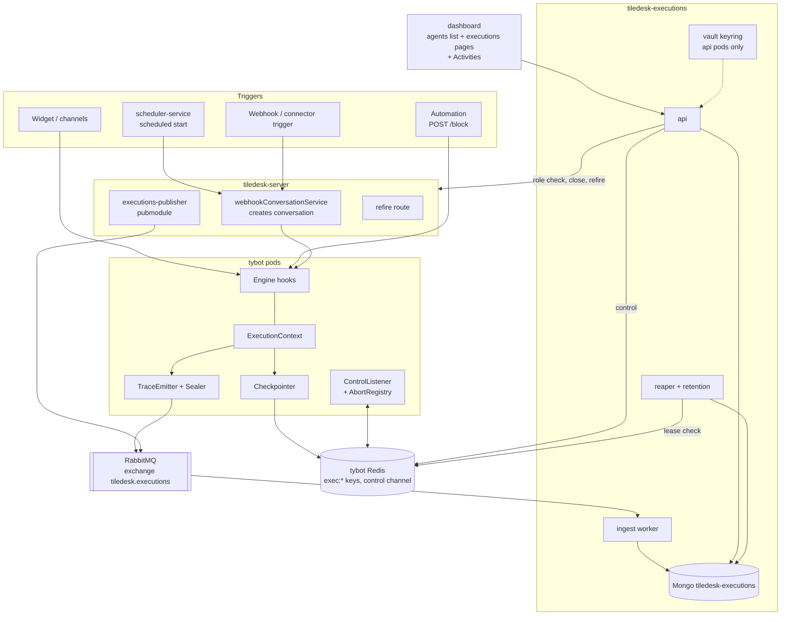
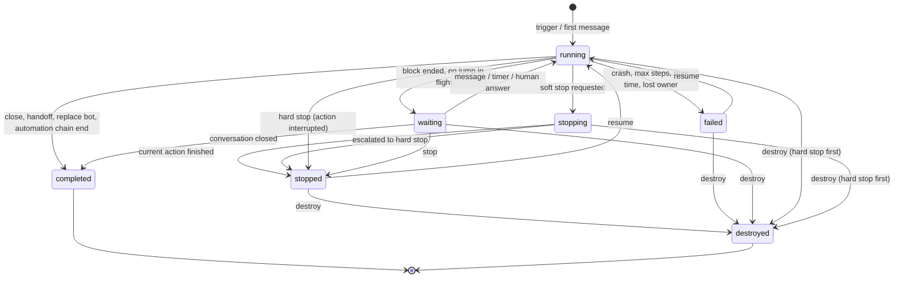
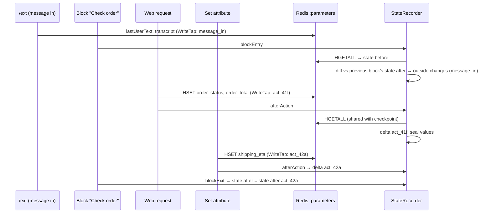
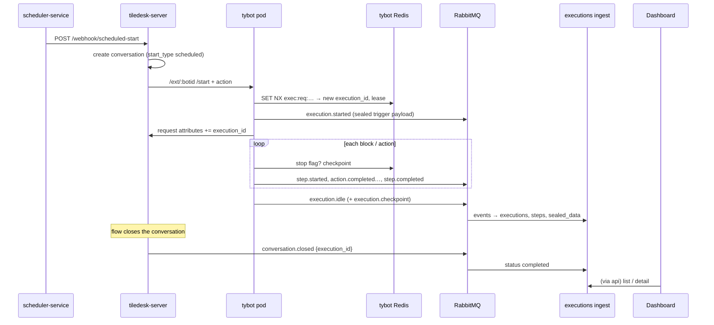
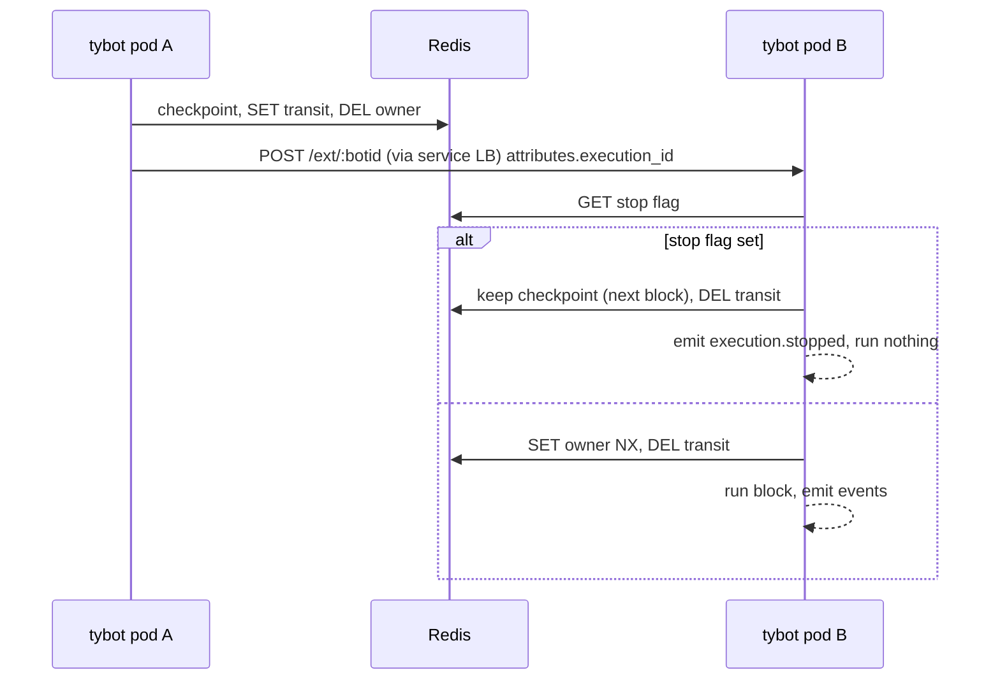
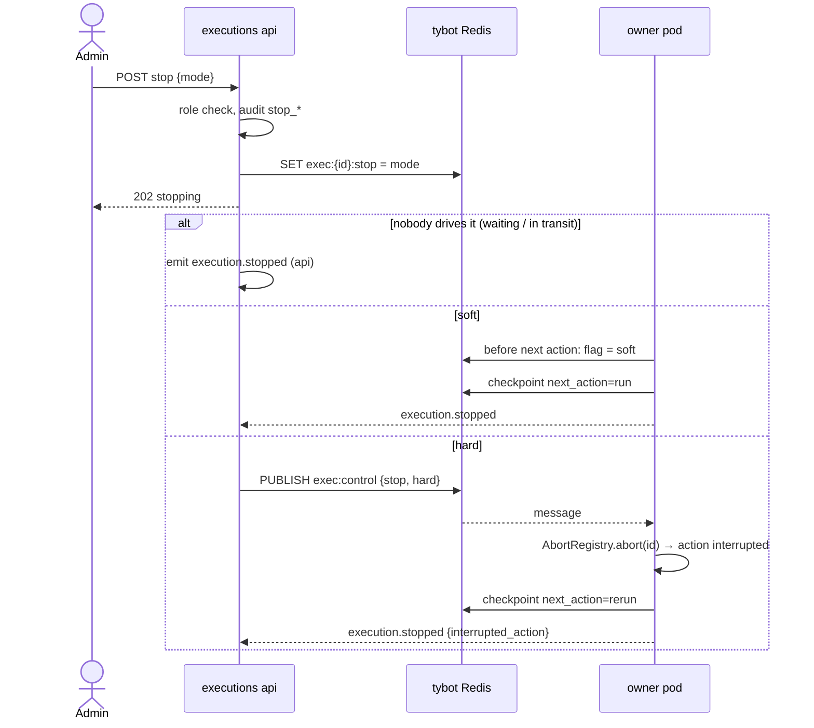
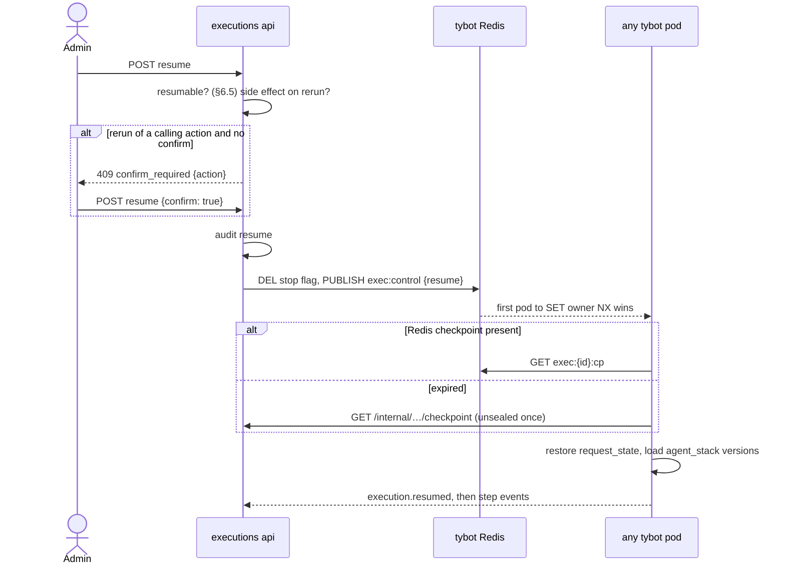
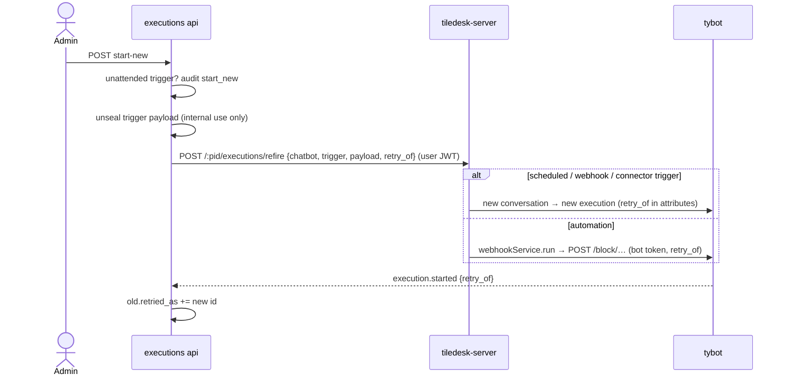
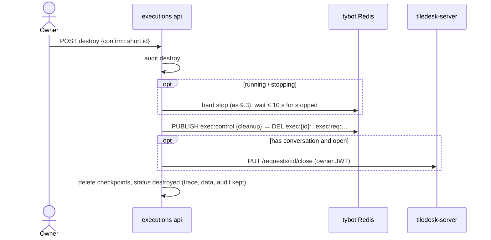
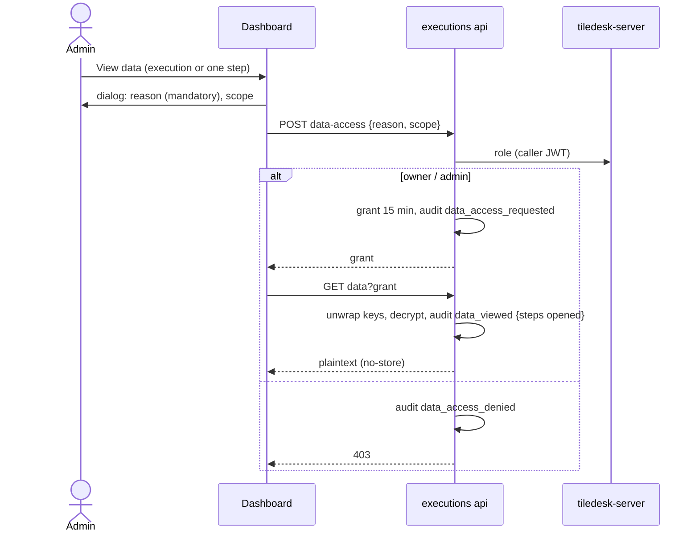

# Agent execution traceability and control — design

**Date:** 2026-11-09
**Status:** draft v3 (deep design, dashboard integration + flow state tracking), awaiting approval
**Branch:** `feature/execution-traceability` (tiledesk-chatbot, from `origin/main` af406feb 3.0.5)
**Repos touched:** tiledesk-chatbot (tybot), **new** `tiledesk-executions`, tiledesk-server,
tiledesk-dashboard, tiledesk-scheduler-service (small), tiledesk-argo
**UI mockup:** linked from the review message. Section §11 is the authoritative description.

Decisions taken with Nico are marked **[decided]**. Calls I made are marked **[my call]**.
Everything else follows from those two.

---

## Contents

1. Intent
2. Goals, non-goals, anti-goals
3. Constraints
4. Approaches considered
5. Component map
6. Concepts and status model
7. Components in depth
8. Contracts (events, Redis, APIs)
9. Interaction flows
10. Security and governance
11. User interface
12. Performance and reliability
13. Retention
14. Phases and repos (14.1 local first, from the production baseline)
15. Left to the builder

---

## 1. Intent

Agents (chatbots) run today and leave nothing behind. A project owner cannot tell that an agent
ran, what it did, whether it failed or why, and cannot stop, resume or kill it.

This work gives the project a **monitor of agent executions** for three needs **[decided]**:

- **Traceability and governance:** a durable record of every execution: what started it, which
  blocks ran, what outcome each one produced, how it ended.
- **Control:** soft stop, hard stop, resume, start new, destroy.
- **Unattended executions first:** scheduled agents and webhook/automation starts have nobody in
  the chat to notice a problem. The monitor is the only way anyone will know.

### What exists today (and why it is not enough)

| Today | Where | Gap |
|---|---|---|
| Flow logs: free text lines over AMQP (`Logger.js`, topic `apps.tilechat.logs.<request_id>`) | tiledesk-server `FlowLogs`, TTL 5–30 min; dashboard `bots/flow-webhooks-logs`, DS test panel | debug only, unstructured, only when `FLOW_LOGS_ENABLED`, gone in minutes |
| Analytics events (`agent.intent_matched`, `agent.block_executed`, `agent.flow_error`…) | tiledesk-analytics (ClickHouse) | aggregates, no per-execution history, no control |
| Execution state: attributes, step counter, start time, locked intent/action | tybot Redis (`TdCache`), mostly 24 h TTL | not an entity, cannot be listed or controlled, expires |
| Stop | `TiledeskChatbot.checkStep` (max steps / max time) | safety limits only, nobody outside can stop a run |
| Scheduled agent run log | tiledesk-scheduler-service | records only whether the HTTP fire succeeded, not what the flow did |

## 2. Goals, non-goals, anti-goals

**Goals**

1. Every execution is recorded, attended or not, with its trigger, agent and agent version **[decided]**.
2. A block-by-block trace: start/end time, duration, exit taken, outcome
   (`success`, `failure_condition`, `error`, `interrupted`, `skipped`). Failure conditions are tracked like successes **[decided]**.
3. A clear execution status (§6) plus a count of the failure conditions hit.
4. Controls **[decided]**: **soft stop** (applied from the next block/action), **hard stop**
   (interrupts the running operation now), **resume** from where it was interrupted, **start new**
   (a fresh execution, the failed one is not overwritten), **destroy**.
5. Execution **data** (attribute values, request/response bodies, prompts, trigger payload) is
   **sealed**. It is readable only through an explicit, audited **in-depth access request** **[decided]**.
6. Every control action and every data access is in an append-only audit log: who, when, which
   execution, why **[decided]**. It is read in the dashboard's existing **Activities** page **[decided]**.
7. The **whole flow state** (all flow variables) is tracked before and after every block, and every
   change is tied to the action that made it **[decided]**. Names and "what changed" are in the
   trace; values are data (goal 5).
8. The UI lives **inside the existing dashboard pages**: executions are reached from the agents
   list **[decided]**.

**Non-goals (v1)**

- Aggregate metrics and charts: these stay in tiledesk-analytics.
- Replacing the flow logs (DS test panel, `flow-webhooks-logs`): they keep working. Retiring them is a follow-up.
- Vibe-coder runs in tiledesk-agent-runtime: they already have runs, stop and checkpoints.
- Alerting/notifications on failure (follow-up, §14).
- An approval workflow for data access (prepared, not built, §10.4).

**Anti-goals**: it would be a failure, even if it technically works, if:

- tracing makes conversations noticeably slower (budget §12);
- trace events get lost **silently** (gaps must be visible);
- sensitive values can be seen by anyone without an audit record;
- resume silently repeats a side effect (a POST, an email) without the user being told;
- a stop leaves the execution in an undefined state.

## 3. Constraints

- tybot runs on several pods. Any pod may receive the next message of a conversation, and every
  **block jump is an HTTP post** to `TILEBOT_ENDPOINT/ext/:botid` that can land on another pod.
- The current per-request Redis state expires (24 h). Resume needs its own checkpoint.
- AMQP (RabbitMQ, `@tiledesk/tiledesk-multi-worker` Publisher) is available to tybot and the server.
- Auth: Tiledesk user JWT (`sub: "user"`) plus project roles, checked through tiledesk-server, like
  the scheduler-service console.
- Branching: one feature branch per repo, cut from that repo's default branch, merged separately
  into the default branch and the pre branch (`main` / `main_pre` for tybot). Never pre into default.

## 4. Approaches considered

| | Where the execution record lives | Trade-off |
|---|---|---|
| A | inside tiledesk-server (Mongo), extending the `FlowLogs` AMQP consumer | fastest, auth already there; but every turn of every bot writes into the main DB and loads the server; vault and audit share the business DB |
| **B [decided]** | **new dedicated service `tiledesk-executions`**, own Mongo | isolated volume and scaling, clear governance boundary (vault with its own key and credentials); one more service to run |
| C | extend tiledesk-analytics (ClickHouse) | great for append volume and TTL; poor for mutable status, control and record-level audit; mixes governance with metrics |

## 5. Component map



| Component | Repo | New / changed | Job in one line |
|---|---|---|---|
| Engine hooks, ExecutionContext, TraceEmitter, Sealer, Checkpointer, ControlListener, AbortRegistry, OutcomeMapper | tiledesk-chatbot | changed | produce the trace, keep checkpoints, obey stop/resume |
| abortable directives | tiledesk-chatbot | changed | let hard stop cut long operations |
| `executions-publisher` pubmodule | tiledesk-server | new | tell the service when a conversation closes / bot leaves / bot is replaced |
| refire route | tiledesk-server | new | "start new" for scheduled, webhook and connector-trigger executions |
| `execution_id` on the conversation | tiledesk-server | changed (attribute only) | link conversation ↔ execution |
| ingest worker | tiledesk-executions | new | consume events, build executions and steps, detect gaps |
| api | tiledesk-executions | new | query, control, data access, audit; only place that holds the private keys |
| reaper + retention | tiledesk-executions | new | find executions whose owner died, apply retention |
| Executions pages + Activities verbs | tiledesk-dashboard | new pages under `bots/`, changes to `bots-list`, `activities-new`, `users-new-role` | list, detail (timeline, flow state, audit tab), controls, data access; audit rows in Activities |
| run log ↔ execution link | tiledesk-scheduler-service | changed (small) | jump from a scheduled run to its execution |
| deployment, keys, queues | tiledesk-argo | changed | run all of it |

## 6. Concepts and status model

- **Execution:** one agent driving one conversation (or one automation run), from its start to a
  terminal state. A chat conversation's execution spans many turns, `waiting` between them.
  A scheduled or webhook fire is one execution.
- **Step:** one block (intent) run inside an execution, with its **actions** (directives) as
  sub-entries. Each step carries its own `agent_id` / `agent_version`, because a subagent call
  (`CALL_SUBAGENT` … `RETURN_STACK`) stays **in the same execution** **[my call]**. Today a
  subagent call is a participant swap on the server (`DirCallSubagent` → `PUT /requests/:id/replace`),
  the same call Replace bot makes, so the design has to tell them apart explicitly (§7.1.2, §7.3).
- **Agent identity:** `agent_id` is the chatbot's **root (draft) id**. `agent_version` is the
  **published snapshot id** that `/ext/:botid` receives. A republish during an open conversation
  doesn't split the execution: the next steps just carry the new version **[my call]**.
- **Checkpoint:** everything needed to continue from a given action (§7.1.5).
- **Replace bot:** the current execution ends `completed` (`end_reason: handed_to_bot`) and a
  **child execution** starts with `parent_execution_id` **[my call]**.

### 6.1 Status model



`failure_conditions` counts steps whose outcome is `failure_condition` (Web Request took its
*false* exit, Ask KB found nothing, a condition's fallback…). The flow designer marks nothing:
each action type maps its exits to an outcome (OutcomeMapper, §7.1.7).

### 6.2 Where an execution begins and ends **[my calls]**

The engine cannot tell "end of flow" from "waiting for the user": a block whose actions run out
and a block jump both end in `theend()`. So the boundaries come from explicit signals.

| Situation | Rule |
|---|---|
| Conversation (widget, channel, webhook, scheduled, connector trigger) | Begins when the bot starts on the conversation and no live execution exists for that request + bot. Ends only on a **conversation event** from tiledesk-server: request closed → `completed` (`closed`), bot left / handoff to human → `completed` (`handed_to_human`), replace bot → `completed` (`handed_to_bot`) + child. |
| Between turns | A block ends with no jump in flight → tybot emits `execution.idle` → `waiting`. That is the normal resting state of a chat, not a failure. |
| Bot comes back on the same conversation | A **new** execution, linked by `previous_execution_id`. |
| Abandoned conversation | Ends when the server closes it (existing auto-close). No timeout in the service. |
| Automation run (`POST /block/...`, `automation-request-…` ids) | Ends when its chain finishes with no jump in flight: tybot emits `execution.ended` (`completed`), or `failed`. |
| New message on a conversation whose execution is `failed` | Starts a **new** execution (`previous_execution_id`), keeping today's behaviour where the user can go on typing after `max_steps`/`max_time`. From then on, the failed one can no longer be resumed (there is a newer one on the same conversation) **[my call]**. |
| New message while `stopped` | Blocked: recorded as `message_while_stopped`, the bot doesn't answer (§7.1.2). |

**tybot learns about terminal states** through Redis: when ingest projects a terminal status
(`completed`, `failed`, `destroyed`), it deletes `exec:req:{request_id}:{agent_id}` and sets
`status` in `exec:{id}` (ingest gets the same limited Redis ACL user as the api). The next
`/ext` then creates a new execution instead of continuing a finished one.

That holds for a message from outside (a user message, a server event). tybot's own continuations
(a block jump posted from a traced action carries `attributes.execution_id`, a resume too) never
create one: when the hinted execution has ended or is gone and no live execution holds the request
key, the continuation runs unrecorded. Example: the conversation is closed while a Wait runs; the
execution ends `completed` (`closed`), the wait ends, the flow jumps on as it always did, and nothing
is recorded for it (no phantom execution without start block or lineage left `waiting`). A user
message on the reopened conversation starts a new execution as usual.

### 6.3 Automation runs (no conversation)

In scope (unattended). Differences from conversation executions:

- no `conversation_link`; trigger `automation` with the webhook id;
- **stop while a sync caller is waiting** on `/webhooks/<request_id>`: tybot publishes a
  `WebResponse` with `{"error":"execution_stopped","execution_id":…}` (HTTP 409) so the caller isn't
  left hanging;
- **resume** is allowed, and the resumed run cannot answer the original sync caller (the UI says so);
- **start new**: through the server's refire route like every other trigger (§7.3). The server
  goes through `webhookService.run`, which mints the bot token, applies the rate limit and
  emits `webhook.triggered`. The service never calls tybot's `/block` itself;
- **destroy**: no conversation to close; only state and checkpoints are deleted.

### 6.4 Design Studio test runs

Recorded with `test: true` (draft bot, no `root_id`). Hidden by default, 7-day retention, no
resume, no start new (a draft has no published snapshot) **[my call]**.

### 6.5 Which controls apply when

| Status | Soft stop | Hard stop | Resume | Start new ¹ | Destroy |
|---|---|---|---|---|---|
| running | ✓ | ✓ | — | — | ✓ |
| waiting | ✓ ² | ✓ ² | — | — | ✓ |
| stopping | — | ✓ (escalate) | — | — | ✓ |
| stopped | — | — | ✓ ³ | ✓ | ✓ |
| failed | — | — | ✓ ³ | ✓ | ✓ |
| completed | — | — | — | ✓ | — |
| destroyed | — | — | — | ✓ | — |

¹ unattended triggers only (scheduled, webhook, connector trigger, automation), never for test runs.
² nothing is running: both apply immediately and behave the same.
³ needs a checkpoint, the agent version (snapshot) still loadable, an open conversation (or none,
for automation), and no newer execution on the same conversation.

## 7. Components in depth

### 7.1 tybot (tiledesk-chatbot `tybotRoute`)

New folder `tybotRoute/executions/`, kept apart from the engine so the hooks in existing files
stay one-liners.

#### 7.1.1 Modules

| Module | Responsibility |
|---|---|
| `ExecutionContext` | the execution in hand for this block: ids, agent and version, trigger, current block/action, `AbortSignal`. Built or loaded at block entry. |
| `ExecutionStore` | Redis access for all `exec:*` keys (§8.2): resolve/create the execution for a request, seq, lease, stop flag, checkpoint. |
| `TraceEmitter` | builds events (§8.1), publishes on `tiledesk.executions`, never awaited by the flow; bounded buffer + drop counter. |
| `Sealer` | envelope-encrypts data blocks with the service public key; strips secrets first (§10.2). |
| `Checkpointer` | writes the checkpoint after each action; restores request state on resume. |
| `ControlListener` | subscribes to `exec:control`; hard stop → AbortRegistry; resume → takes the lease and drives. |
| `AbortRegistry` | per-pod `Map<execution_id, AbortController>` for the blocks this pod drives. |
| `OutcomeMapper` | per action type: exit taken → `success` / `failure_condition`; thrown error → `error`. |
| `StateRecorder` | flow state before/after every block and every action (§7.1.10): reads the `:parameters` hash, computes the delta, attributes each change to the action that wrote it, hands values to `Sealer`. Shares the hash read with `Checkpointer`. |
| `WriteTap` | records which keys the running action writes. Called from the three places that write flow variables (§7.1.10). |

#### 7.1.2 Hook points in existing code

| Where | What it does |
|---|---|
| `index.js` `POST /ext/:botid` (message in, incl. block jumps) | resolve or create the execution (`ExecutionStore.resolve(request_id, bot_id)`); if a jump carries `execution_id`, use it; **check the stop flag before running anything**; take the lease; build `ExecutionContext`. If stopped: emit `execution.message_while_stopped`, answer 200, run nothing. |
| `index.js` `POST /block/:project_id/:bot_id/:block_id` (automation) | create the execution with trigger `automation`; same as above. |
| `TiledeskChatbot.execIntent` | `StateRecorder.blockEntry()`: read the whole state (state **before** the block), diff it against the state recorded at the end of the previous block (changes made outside the flow); emit `step.started` (block id/name, agent, version, state before). |
| `DirectivesChatbotPlug.nextDirective`, next to the existing `checkStep` | before each action: check the stop flag (soft → stop here, checkpoint `next_action = this one`), `WriteTap.begin(action_id)`; after each action: OutcomeMapper, `StateRecorder.afterAction()` (delta of this action), seal data, emit `action.completed`, write checkpoint (same hash read). Existing `checkStep` errors → `execution.failed` (`max_steps_exceeded` / `max_time_exceeded`). |
| `DirectivesChatbotPlug.process` (`theend`), and the post-action callback when `stop` is true | `StateRecorder.blockExit()` (state **after** the block = state after its last action); emit `step.completed`. If no jump is in flight → `execution.idle` (conversation) or `execution.ended` (automation). Release the lease. |
| `TiledeskChatbot.addParameterStatic` / `deleteParameterStatic`, `TiledeskRequestVariables.set` / `delete` (used by the Code action) | one line each: `WriteTap.note(requestId, key, op)`. These are the only writers of `:parameters` in tybot today. |
| `index.js` `POST /ext/:botid`, around `TiledeskChatbotUtil.updateRequestAttributes` and `updateConversationTranscript` (message in) | `WriteTap.scope(source: "message_in")` around both calls, so the variables refreshed by an incoming message (`lastUserText`, `lastUserMessage`, `transcript`…) are labelled as such instead of "changed outside the flow". |
| `TiledeskChatbot` intent invocation with parameters (`/intentName{…}`, ~l.170: `this.addParameter` before `execIntent`, not awaited) | await those writes and tap them with `source: "jump_params"` **[my call]**. |
| `DirIntent`, `DirConnectBlock`, `DirReturnStack` (jumps), state side | before posting the jump: `afterAction` + checkpoint write + `blockExit` are **awaited**, so the next block (same or other pod) reads a checkpoint that already holds the state after this block **[my call]**. Today `DirIntent` calls back only after `sendMessageToBot` returns, so without this the next block can start before the previous one has recorded its exit. |
| `DirIntent`, `DirConnectBlock`, `DirReturnStack` (jumps) | add `execution_id` to the posted message attributes; set `exec:{id}:transit = now`; release the lease. |
| `DirReplaceBot*` | emit `execution.handed_to_bot` with the new bot id; the next `/ext` for the new bot creates the child with `parent_execution_id`. |
| `DirCallSubagent` | before the swap: `SET exec:req:{request_id}:{subagent_root_id} = <current execution_id>` (an alias, so the subagent's first `/ext`, which arrives through `sendSupportMessage` without `execution_id`, resolves to the **same** execution) and push a frame on `agent_stack`; the replace call carries `reason: "subagent_call"`. |
| `DirReturnStack` | pop the frame, delete the alias, replace call with `reason: "subagent_return"`. |
| `DirMoveToAgent`, `DirInviteHuman` and similar handoffs | nothing: the end is decided by the server event (§6.2). |
| long-running directives (§7.1.6) | accept `ctx.signal`. |
| `pushCallerSnapshot` / attribute updates to the server | add `execution_id` to request attributes once, at creation (async). |

#### 7.1.3 Execution resolution

```
resolve(request_id, agent_id /* root id */, hinted_execution_id?)
  if hinted_execution_id and exec:{id} exists → that one
  else GET exec:req:{request_id}:{agent_id}          // may be a subagent alias
     exists and not terminal → that one
     else create: id = uuidv7(), SET exec:req:{request_id}:{bot_id} = id,
                  HSET exec:{id} meta, emit execution.started
```

Creation is guarded by `SET NX` on the request key so two pods receiving the first two messages
of a conversation at once cannot create two executions.

#### 7.1.4 Lease, transit and stop flag

- Taking a block: `SET exec:{id}:owner <pod_id> NX PX 15000`. If held by another pod (two messages
  at once in the same conversation), the message is processed as today: tybot already serialises
  per request with its intent/action locks. The lease only answers "who drives right now", for
  hard stop and the reaper.
- Heartbeat every 5 s while the block runs (`PEXPIRE`), release at block end.
- Jump: `SET exec:{id}:transit <ts> PX 120000` before posting, `DEL` when the next pod takes the block.
- Stop flag `exec:{id}:stop` = `soft` | `hard`, read **at block entry and before every action**.

#### 7.1.5 Checkpoint content

`exec:{id}:cp` (JSON, TTL `EXECUTIONS_CHECKPOINT_TTL`, default 7 d **[my call]**):

```
{ version: 1, seq, block_id, action_index, next_action: "run" | "rerun",
  agent_stack: [{ agent_id, agent_version, return_block }],      // subagent frames
  request_state: { parameters: {…}, locked_intent, locked_action, step, started },
  trigger: { type, source_id, start_point_id }, written_at }
```

`request_state` is a copy of the request cache keys `TiledeskChatbot.requestCacheKey(request_id)`
(`:parameters`, intent/action locks; `:step` and `:started` are kept for the record). Restoring
writes them back before the block runs, **except the limits**: resume resets `:step` to 0 and
`:started` to now. Resuming is a deliberate human decision, so `MAX_STEPS` / `MAX_EXECUTION_TIME`
count again from the resume. This makes `max_steps_exceeded` / `max_time_exceeded` failures
resumable too **[my call]**.

**Token and request context on resume.** Resume arrives by pub/sub, with no `/ext` body, so no
bot token and no `payload.request`. The resuming pod mints the bot token itself, the same way
the server does (`webhookService.generateChatbotToken`: tybot already loads the bot with
`+secret`). It then fetches the request from the server with that token. Neither is ever stored
in the checkpoint **[my call]**. Whenever the execution parks (`waiting`, `stopped`, `failed`), the checkpoint is also
sent **sealed** to the service (`execution.checkpoint` event) so it survives the Redis TTL.

#### 7.1.6 Hard stop and abortable directives

- `ControlListener` receives `{type:"stop", mode:"hard", execution_id}`. If this pod's
  AbortRegistry holds it, it calls `abort()`.
- Directives pass `ctx.signal` to what they wait on: axios (`signal`), LLM clients, `setTimeout`
  in `DirWait` (cleared on abort), KB/QA calls.
- Order for phase 2 (by how long they can block): GPT task / AI prompt / Ask KB, web request
  v1/v2, Wait, code/integration calls, send email / WhatsApp. Directives without abort support
  degrade to soft for that action (`hard_degraded: true`).
- On abort, the action ends with outcome `interrupted`, the checkpoint gets `next_action: "rerun"`,
  and `execution.stopped` is emitted with `interrupted_action`.

#### 7.1.7 OutcomeMapper

A table keyed by action type. Examples (full table in the tybot plan):

| Action | success | failure_condition |
|---|---|---|
| Web request v2 | `trueIntent` taken | `falseIntent` taken |
| Ask KB / AI prompt | answer found | `falseIntent` / no answer |
| JSON condition / condition | the matching branch | the fallback branch, only if it is marked as else-on-error in the action config, otherwise success |
| Capture user reply | reply received | `timeout` exit |
| Others (reply, set attribute…) | completed | — |

A thrown error is always `error`.

**Which exit was taken.** The directive says it: at the point where it picks its branch
(`#executeCondition(result, …)`, or its inline `if`) it calls `WriteTap.noteExit('trueIntent' |
'falseIntent' | 'errorIntent' | 'fallbackIntent' | 'noMatchIntent' | 'noInputIntent' | 'goToIntent' |
'jump')` on the running action's store. The mapper uses that signal first: a failure field
(`falseIntent`, `noMatchIntent`, `noInputIntent`, `errorIntent`) gives `failure_condition`, anything
else `success`, and `exit_taken` is the field without `Intent`. The signal stands with no jump too (a
false result with no block connected is `failure_condition` / `false`). Only without a signal is the
jump target matched against the exit fields; if it matches both a failure and a success exit (both
exits on the same block) the branch is unknown and the record is `success` with `exit_taken:
'ambiguous'`, never `failure_condition`. Flag off, `noteExit` is a no-op (no action store exists).

#### 7.1.8 Configuration

| Env | Default | Purpose |
|---|---|---|
| `EXECUTIONS_ENABLED` | `false` | master switch: no events, no checkpoints, no controls |
| `EXECUTIONS_AMQP_URL` | `AMQP_MANAGER_URL` | broker |
| `EXECUTIONS_SEAL_PUBLIC_KEY`, `EXECUTIONS_SEAL_KID` | — | sealing (no key → data not captured, trace still on) |
| `EXECUTIONS_SERVICE_TOKEN` | — | tybot ↔ service internal calls |
| `EXECUTIONS_SERVICE_URL` | — | internal checkpoint fetch |
| `EXECUTIONS_CHECKPOINT_TTL` | `604800` | Redis checkpoint TTL (s) |
| `EXECUTIONS_BUFFER_MAX` | `10000` | events kept in memory while the broker is down |
| `EXECUTIONS_DATA_MAX_BYTES` | `262144` | per-action sealed data cap (truncated with a marker) |

#### 7.1.9 Failure modes

| Failure | Behaviour |
|---|---|
| broker down | buffer, then drop + `executions_events_dropped_total`; service shows the gap |
| Redis down | tracing degrades to events only (no checkpoint, no stop); flow runs as today; metric |
| sealing fails | trace event sent without data, `data_missing: true` |
| pod dies mid-block | lease expires; the reaper marks `failed` (`lost_owner`); resumable from the last checkpoint |

#### 7.1.10 Flow state tracking (variables before / after every block)

**What the code does today.** All flow variables of a conversation live in one Redis hash,
`TiledeskChatbot.requestCacheKey(request_id) + ":parameters"`, one field per variable, value as
a JSON string (up to 20 MB per value, TTL `FLOW_ATTRIBUTES_TTL`). Three places write it:
`TiledeskChatbot.addParameterStatic` / `deleteParameterStatic` (every directive and the
incoming-message refresh in `TiledeskChatbotUtil.updateRequestAttributes` and
`updateConversationTranscript`, both through `chatbot.addParameter`), and `TiledeskRequestVariables.set` / `delete` (the Code action, which
writes raw strings). Nothing records who changed what. `TiledeskChatbotUtil.userFlowAttributes`
already splits user variables from reserved/system ones (`_*`, `support-group-*`, the
`RESERVED` list).

**What gets recorded.** For every block (intent) and every action in it:

| Point | Recorded |
|---|---|
| block entry (`execIntent`) | **state before**: the whole hash |
| after each action | **delta** of that action: every key set or deleted, `before` → `after` |
| block exit (`theend` / stop / jump) | **state after**: the state after the block's last action |
| between two blocks | **outside changes**: diff between the previous block's state after and this block's state before. Labelled `message_in` when `WriteTap` saw the incoming-message refresh, `external` otherwise (another pod, a server-side attribute write, an API) |

So the whole flow state is known before and after every block, and each change is tied to the
action (or the message, or "outside") that made it.

**How (my calls).**

- One `HGETALL` per action. The checkpoint already needs it (§7.1.5), so `StateRecorder` and
  `Checkpointer` share the read: no extra Redis call per action, one extra at block entry. The
  previous snapshot is kept in memory on the pod for the block it drives; on a block jump to
  another pod, the new pod takes it from the checkpoint (`request_state.parameters`).
- The diff is computed on the **raw Redis strings**, so it is exact whatever writer was used
  (JSON-encoded or raw Code action values).
- `WriteTap` keeps the tap per running action, keyed by `execution_id + step_seq + action_index`
  (not by request, since two blocks of one request can overlap on a pod during a jump), found
  through `AsyncLocalStorage` set by the directive loop. Writes outside any action context go to
  the `message_in` / `jump_params` scopes. A key in the delta that no tap saw is marked
  `by: "external"` (a concurrent write), not attributed to the action.
- **Clear manifest.** Every keyframe also carries an **unsealed manifest** of the whole state:
  `[{key, type, size, hash, reserved}]`, no values. It is recorded even when `capture_data =
  false`. With the manifest plus the clear deltas, the api rebuilds the full variable list
  before/after any block (names, types, sizes, "changed / unchanged") **without decrypting**;
  only values need a grant. This is what Phase 1 shows.
- **Storage: keyframes + deltas.** A full sealed snapshot (keyframe) at execution start, on
  resume, and then every 20 blocks or when the deltas since the last keyframe exceed 1 MB. In
  between only deltas. Any "state before/after block N" is rebuilt by the api as keyframe +
  deltas. This avoids storing the whole `transcript` (which grows every turn) on every block.
- **What is in clear and what is sealed.** In clear, in the trace: key name, `op`
  (`set`/`del`/`add`), value type, size, a keyed hash of the value (`HMAC-SHA256` with a
  per-project key held by tybot, so "same value as before" is visible without the value),
  `reserved: true|false`, `by` (action id / `message_in` / `external`). **Sealed**: the values
  (`before` and `after`). Seeing values requires an in-depth data access grant (§9.7), like any
  other data.
- Secrets: keys whose names match the secret rules of §10.2 are recorded as `[secret]` (name
  and op only, no hash).
- Values over `EXECUTIONS_STATE_VALUE_MAX_BYTES` (default 256 KB) are not stored: the delta
  keeps type, size and hash with `omitted: "too_large"`.
- `capture_data = false` (§13) → only the clear part (names, ops, sizes, hashes) is recorded.

Delta record (inside `action.completed`, `step.started` for outside changes):

```json
{ "state_delta": [
    { "key": "order_total", "op": "set", "type": "number", "size": 6,
      "hash_before": "b1c…", "hash_after": "9fe…", "reserved": false, "by": "act_41f" },
    { "key": "lastUserText", "op": "set", "type": "string", "size": 18,
      "hash_after": "07a…", "reserved": true, "by": "message_in" } ],
  "sealed_state": { "kid": "…", "ct": "…" },          // before/after values of the keys above
  "state_keyframe": false,
  "state_manifest": null }                               // set on keyframes: [{key,type,size,hash,reserved}]
```

Config: `EXECUTIONS_STATE_ENABLED` (default `true` when `EXECUTIONS_ENABLED`),
`EXECUTIONS_STATE_VALUE_MAX_BYTES`, `EXECUTIONS_STATE_KEYFRAME_EVERY` (20),
`EXECUTIONS_STATE_KEYFRAME_MAX_DELTA_BYTES` (1 MB), `EXECUTIONS_STATE_HASH_KEY`.



### 7.2 tiledesk-executions (new service)

TypeScript, same conventions as tiledesk-scheduler-service (Express, zod, pino, Prometheus,
helm chart). **Three deployments from one image** so that keys and load are separated:

| Deployment | Does | Holds private keys |
|---|---|---|
| `ingest` | consumes `executions.ingest`, writes Mongo | **no** |
| `api` | REST for the dashboard, control, data access, audit, internal checkpoint endpoint | **yes** (only here) |
| `jobs` | reaper (every 15 s), retention sweeps, gap re-check | no |

#### 7.2.1 Ingest

- Validates each event against the contract (§8.1). Invalid → DLQ.
- Idempotent on `(execution_id, seq)` (unique index on `events_seen`, TTL 2 d).
- Events of one execution may arrive out of order (several consumers, several pods): the
  **projection** applies them by `seq` and keeps `last_seq`. Status changes only move forward
  along §6.1. A late event for an earlier seq updates its step but never moves the status back.
- Gap detection: when `execution.idle` / `ended` / `stopped` arrives, missing seqs below it are
  recorded in `missing_seq`. The `jobs` deployment re-checks after 60 s; still missing →
  `trace_complete: false`.
- Sealed blocks go to `sealed_data` as-is. Ingest never decrypts.
- Terminal write-back: on `completed` / `failed` / `destroyed`, ingest updates tybot Redis (§6.2).
- Server conversation events arrive for **every** request that had a bot participant (§7.3).
  Ingest matches them by `request_id` (and `execution_id` when present) and drops the ones that
  match no execution.

#### 7.2.2 API

Routes in §8.4. Middleware: JWT verify (`GLOBAL_SECRET[_OR_PUB_KEY]`, `aud`/`iss` as the
scheduler console, `sub` must be `user`) → project role through tiledesk-server
(`GET /:projectid/project_users/me` with the caller's JWT, cached 60 s) → role check (§10.1).

Control writes to **tybot Redis** under `exec:*` only (a dedicated Redis user with an ACL limited
to `exec:*` keys and the `exec:control` channel) **[my call]**.

#### 7.2.3 Jobs

- **Reaper:** for executions `running` with no `exec:{id}:owner` and no `transit` (or `transit`
  older than 60 s), and `last_event_at` older than 30 s → `failed` (`lost_owner`).
  For `stopping` with no owner → `stopped`.
- **Retention:** per-project policy (§13); Mongo TTL indexes on `retention.trace_until` /
  `data_until`; audit has its own TTL.

#### 7.2.4 Mongo collections and indexes

| Collection | Key fields | Indexes |
|---|---|---|
| `executions` | §8.3 | `{id_project, started_at:-1}`, `{id_project, status, started_at:-1}`, `{id_project, agent_id, started_at:-1}`, `{request_id}`, `{retention.trace_until}` TTL |
| `steps` | `execution_id, seq, block…, actions[]` | `{execution_id, seq}` unique |
| `sealed_data` | `execution_id, seq, kind (action|trigger|state_delta|state_keyframe), kid, wrapped_key, iv, ct, size` | `{execution_id, seq}`, `{execution_id, kind, seq}`, `{data_until}` TTL |
| `state_manifests` | `execution_id, seq, step_seq, at: before, vars[{key, type, size, hash, reserved}]` (keyframes only, no values) | `{execution_id, seq}`, `{retention.trace_until}` TTL |
| `state_changes` | clear part of §7.1.10: `execution_id, seq, step_seq, action_id?, by, key, op, type, size, hash_before, hash_after, reserved` | `{execution_id, step_seq}`, `{execution_id, key, seq}` (a variable's history), `{retention.trace_until}` TTL |
| `checkpoints` | `execution_id, seq, sealed…` | `{execution_id}` unique |
| `grants` | `grant_id, execution_id, user_id, scope, expires_at, status` | `{expires_at}` TTL |
| `audit_log` | §8.3 | `{id_project, at:-1}`, `{execution_id, at:-1}`, `{at}` TTL 1 y |
| `events_seen` | `execution_id, seq` | unique, TTL 2 d |

The `api` Mongo user can read everything and write `grants`, `audit_log`, `executions` (control
status). The `ingest` user cannot read `grants` or `audit_log`. Only `api` has `insert` on
`audit_log`, and no user has `update`/`delete` on it.

#### 7.2.5 Configuration

`MONGO_URI`, `AMQP_URL`, `TYBOT_REDIS_URL` (ACL user), `TILEDESK_API_URL`, `JWT_*`,
`EXECUTIONS_SERVICE_TOKEN`, `VAULT_KEYS` (api only: list of
`kid` → private key), `DEFAULT_RETENTION_*`.

### 7.3 tiledesk-server

| Change | Detail |
|---|---|
| `pubmodules/executions-publisher` | like `analytics-publisher`: listens to `request.close` / `request.close.extended`, `request.participants.leave` (bot), and the replace-bot participant change. Publishes `conversation.closed`, `conversation.bot_left`, `conversation.bot_replaced` on `tiledesk.executions` for **every request that has or had a bot participant**, with `execution_id` when the attribute is already there. It does not gate on the attribute, because tybot writes it asynchronously and an early close would otherwise lose the only end signal **[my call]**. Replace calls with `reason: subagent_call|subagent_return` publish nothing (the execution continues). Disabled when `EXECUTIONS_AMQP_URL` is unset. Runs where those listeners run today (API and job worker, queue mode included). |
| `PUT /requests/:id/replace` | accepts an optional `reason` (`subagent_call`, `subagent_return`), passed through to the participant event. No behaviour change. |
| `execution_id` attribute | written by tybot through the existing attributes update. No schema change. Shown in the conversation detail with a link (dashboard). |
| refire route `POST /:projectid/executions/refire` | user JWT, owner/admin. Body `{ chatbot_id, trigger: {type, start_point_id}, payload, retry_of }`. Scheduled → the same code path as `/webhook/scheduled-start` (live snapshot, rate limit) but authenticated by the user; webhook / connector trigger → `webhookConversationService.start` with the stored payload and that start point; automation → `webhookService.run` with the stored payload (mints the bot token, rate limit, `webhook.triggered`). `retry_of` goes into the new conversation's attributes so the new execution links back. |
| close for destroy | the service calls the existing `PUT /:projectid/requests/:id/close` **with the user's JWT**: the close is done by that person and shows up as such in the conversation. |
| **audit → Activities** | the same `executions-publisher` module also **consumes** `audit.recorded` (queue `server.executions.audit`, bound to `audit.#` on `tiledesk.executions`) and saves one `Activity` per entry through `pubmodules/activities` (§7.3.1). |
| permissions | new permission strings for custom roles (§10.1), checked with the existing `roleChecker.hasRoleOrTypes(role, types, permission)`: standard roles go by the hierarchy in `middleware/has-role.js`, custom roles by their `permissions`. The service needs the caller's role **and**, for a custom role, its permissions: `project_users/me` gives the role, and the server attaches `rolePermissions` to the project user in `projectUserService.getWithPermissions`. Whether `/me` serialises it for custom roles, or the service must read the role via the roles API, is for the builder to confirm (§15). |

#### 7.3.1 Execution audit in the existing Activities

**What exists.** `pubmodules/activities` stores `Activity` documents (`actor`, `verb`, `target`,
`actionObj`, `related`, `involvedUserIds`, `id_project`) from server events, and
`GET /:projectid/activities` (+ `/csv`) serves the dashboard Activities page, filtered by
`activities` (verbs), `agent_id`, dates. The route is mounted with `hasRole('admin')`. Two limits
matter here: activities are saved only when `ACTIVITY_HISTORY_ENABLED=true`, and the collection
has one TTL index on `createdAt`, 30 days by default (`ACTIVITY_EXPIRATION_TIME`).

**Design (my calls).**

- The service's `audit_log` stays the **record of authority**: always on, append-only, 1 year
  (§10.4). It cannot depend on a flag that can be off, nor on a 30-day TTL.
- Every audit entry is **mirrored** into Activities, so governance is read in the one place users
  already use. The service publishes `audit.recorded`; the server saves:

  | Field | Value |
  |---|---|
  | `actor` | `{type: "user", id: user_id, name}` (from the audit entry) |
  | `verb` | `EXECUTION_STOP_SOFT`, `EXECUTION_STOP_HARD`, `EXECUTION_RESUME`, `EXECUTION_START_NEW`, `EXECUTION_DESTROY`, `EXECUTION_DATA_ACCESS`, `EXECUTION_DATA_ACCESS_DENIED`, `EXECUTION_RETENTION_UPDATE` |
  | `target` | `{type: "execution", id: execution_id, object: {agent_id, agent_name, request_id, status_after, trigger_type}}` |
  | `related` | `{role: "agent", type: "faq_kb", id: agent_id, name: agent_name}` |
  | `actionObj` | `{mode?, reason?, scope?, step_seq?, grant_id?, result, audit_id}` (never data) |

  `audit_id` makes the save idempotent (unique sparse index on `actionObj.audit_id`).
- `data viewed` is folded into `EXECUTION_DATA_ACCESS` (`actionObj.result: "viewed"`) to keep the
  Activities list readable; the service audit keeps both entries.
- **Owner-only stays owner-only.** The Activities route is admin-level, but the role table says
  only owners read the audit. `GET /activities` and `/csv` drop `EXECUTION_*` verbs for callers
  who are not owners (and, for custom roles, who lack `executions_audit_read`). Admins keep
  seeing all other activities as today.
- Activities older than the 30-day activity TTL disappear from the Activities page, as all
  activities do. The full year is in the execution detail (Audit tab, read from the service) and
  in the service audit export.
- When `ACTIVITY_HISTORY_ENABLED` is off, the mirror is skipped and the execution detail's Audit
  tab is still complete. The deploy enables it where executions are enabled.
- Verbs and icons are added to the dashboard's `ACTIVITY_FILTER_OPTION_DEFINITIONS` (new group
  `Executions`) and `ACTIVITY_ICON_BY_VERB`, and the sentences to `activity-message.util.ts`
  (§11.7). The **server** builds sentences too: `activityMessageUtil.buildDefaultActivityMessage`
  (used by `enrichActivityWithMessage` for the list and by `buildCsv`, with the it/en switch) gets
  the `EXECUTION_*` cases in both languages, so the CSV and the list carry the same text.
  `docs/activities-client.md` gets the new verbs.

### 7.4 tiledesk-dashboard (Angular 15)

The monitor is **part of the existing pages**, not a new area: executions are reached from the
agents list, and the audit lives in the existing Activities page. No new sidebar item.

| Where (existing code) | Change |
|---|---|
| `bots/bots-list/bots-list.component.html`, card actions (`cl-card-action-group`, next to the `leaderboard` analytics button) | new icon button **Executions** (`manage_history`), shown when `PERMISSION_TO_VIEW_EXECUTIONS`. It carries a small badge with the agent's executions needing attention in the last 24 h (`failed` + `stopped`, red; `running`, blue dot). Also an **Executions** item in the card's `more_vert` menu. For all agent kinds, including webhook/automation flows and copilot (unlike analytics, which hides for webhook/copilot). |
| `bots-list` page header, next to the create buttons | link **All executions** (project-wide list). |
| `bots-list.component.ts` | `PERMISSION_TO_VIEW_EXECUTIONS` / `…_CONTROL_…` set the same way as the other flags (owner/admin true; supervisor true for view, false for control; agent false; custom role from `matchedPermissions`). One batched call `GET /executions/summary?agent_ids=…&since=24h` for the badges of the visible page. |
| new lazy module `src/app/bots/executions/` | routes `project/:projectid/bots/executions` (all agents), `project/:projectid/bots/:botid/executions` (one agent), `project/:projectid/bots/:botid/executions/:executionid` (detail). Guard: `AuthGuard`, like the other bot pages; the permission is checked in the component through `RoleService` (as the other bot pages do), and the API refuses anyway. Must be registered before `bots/:faqkbid/:type` (`app.routing.ts`), which would otherwise match `bots/:botid/executions`. |
| `activities-new` (Activities page) | new filter group **Executions** in `ACTIVITY_FILTER_OPTION_DEFINITIONS` (`groupKey` gets `'Executions'`), icons in `ACTIVITY_ICON_BY_VERB`, sentences in `utils/activity-message.util.ts`, and a component `activities-execution-link` (like `activities-bot-link`) that opens the execution detail. Rows come from `GET /activities` as today (§7.3.1). |
| `users-new-role` (custom role editor), Flows section | checkboxes for the new permissions (§10.1). |
| `utils/permissions.constants.ts` | the new permission keys. |
| conversation detail | "Execution ↗" when `attributes.execution_id` exists. |
| `bots/flow-webhooks-logs` | "View executions" link to the agent's list. |

- `ExecutionsService` → `EXECUTIONS_BASE_URL` from the dashboard runtime config (like analytics).
- Polling: list every 10 s while it shows any `running`/`stopping`; detail every 2 s while
  `running`/`stopping`, otherwise no polling. Badges on the agents list: once on page load.
- All strings through the existing translate pipe (en first, like the other new pages).

### 7.5 tiledesk-scheduler-service (small)

The run log stores the conversation/request id returned by the server on `scheduled-start`. The
console shows "View execution" (dashboard deep link through `request_id` → execution lookup).

### 7.6 tiledesk-argo

New app `tiledesk-executions` (3 deployments, Service, Ingress path `/executions/api`, ServiceMonitor),
Mongo database `tiledesk-executions` with two users (api, ingest), Redis ACL user on tybot Redis,
RabbitMQ exchange `tiledesk.executions` + queue `executions.ingest` + DLQ, Secrets: seal keypair
(public → tybot, private → executions api only), `EXECUTIONS_SERVICE_TOKEN`. Secrets are chart
parameters, never patched by hand.

## 8. Contracts

### 8.1 Events (AMQP)

Exchange `tiledesk.executions` (topic, durable). Routing key `exec.<id_project>.<type>`.
Queue `executions.ingest` bound to `exec.#`, DLQ `executions.ingest.dlq`. Persistent messages.

Envelope (all events):

```json
{ "event_version": 1, "type": "action.completed",
  "execution_id": "0193…", "seq": 17, "at": "2026-11-09T03:00:00.120Z",
  "id_project": "…", "agent_id": "…", "agent_version": "…",
  "request_id": "…", "pod": "tybot-7c9…", "data": { } }
```

| Type | Producer | `data` |
|---|---|---|
| `execution.started` | tybot | `trigger {type, source_id, start_point_id, source_run_id?}`, `agent_name`, `test`, `parent_execution_id?`, `previous_execution_id?`, `retry_of?`, `sealed_trigger_payload?` |
| `step.started` | tybot | `step_seq`, `block_id`, `block_name`, `state_vars` (count), `outside_changes` (`state_delta` of §7.1.10 with `by: message_in|external`), `sealed_state?`, `state_keyframe` (true → `sealed_state` is the whole state before this block) |
| `action.completed` | tybot | `step_seq`, `action_index`, `action_id`, `type`, `title`, `outcome`, `exit_taken`, `duration_ms`, `error_code?`, `hard_degraded?`, `sealed?`, `state_delta`, `sealed_state?` |
| `step.completed` | tybot | `step_seq`, `outcome`, `exit_taken`, `duration_ms`, `state_vars`, `changed_keys` (count) |
| `audit.recorded` | api | routing key `audit.<id_project>.<action>`: the audit entry (§8.3) **plus the display context** the mirror needs: `actor_name`, `agent_name`, `request_id`, `status_after`, `trigger_type`. The api already has them (actor from the server's `/me`, the rest from the execution), so the server consumer does no lookups **[my call]** |
| `execution.idle` | tybot | `last_seq` |
| `execution.checkpoint` | tybot | `sealed` checkpoint, `cp_seq` |
| `execution.stopping` | api | `mode`, `actor` |
| `execution.stopped` | tybot or api (nothing running) | `mode`, `interrupted_action?`, `last_seq` |
| `execution.resumed` | tybot | `from_seq`, `checkpoint_unsealed` |
| `execution.failed` | tybot or jobs | `error_code`, `message` (engine text, never user data), `step_seq?` |
| `execution.ended` | tybot (automation) | `end_reason: completed` |
| `execution.handed_to_bot` | tybot | `to_bot_id` |
| `execution.message_while_stopped` | tybot | — |
| `execution.destroyed` | api | `actor` |
| `conversation.closed` / `bot_left` / `bot_replaced` | server | `request_id`, `execution_id`, `closed_by?`, `to_bot_id?` |

Server events have no tybot `seq`: the projection applies them as terminal events after any seq.

### 8.2 Redis (tybot Redis, `exec:*` namespace)

| Key | Type / TTL | Written by | Meaning |
|---|---|---|---|
| `exec:req:{request_id}:{agent_id}` | string, 7 d | tybot (deleted by ingest at terminal) | live execution for this conversation and agent (root id); also the subagent alias |
| `exec:policy:{id_project}` | hash, no TTL | api | `capture_data` (`true`/`false`), set from the retention settings; tybot caches it 60 s |
| `exec:{id}` | hash, 7 d | tybot | meta: project, agent, trigger, status hint |
| `exec:{id}:seq` | counter, 7 d | tybot | event sequence (`INCR`) |
| `exec:{id}:owner` | string, PX 15 s | tybot | pod driving the current block |
| `exec:{id}:transit` | string, PX 120 s | tybot | a block jump is in flight |
| `exec:{id}:stop` | string, 7 d | api | `soft` / `hard` |
| `exec:{id}:cp` | string (JSON), 7 d | tybot | latest checkpoint |
| channel `exec:control` | pub/sub | api | `{type: stop|resume|cleanup, execution_id, mode?}` |

### 8.3 Records (service Mongo)

**executions**

```
_id (execution_id, uuid v7), id_project, agent_id, agent_name, agent_version, test
request_id, conversation_link
trigger: { type: scheduled|webhook|trigger|automation|widget|channel, source_id, start_point_id, source_run_id }
status, end_reason, error: { code, message, step_seq }
failure_conditions, steps_count, actions_count
started_at, ended_at, last_event_at, duration_ms, last_seq
parent_execution_id, previous_execution_id, retry_of, retried_as[]
trace_complete, missing_seq[], has_checkpoint, has_data
retention: { trace_until, data_until }
```

**steps**: `execution_id, seq, agent_id, agent_version, block_id, block_name, started_at,
ended_at, duration_ms, outcome, exit_taken, actions[{ index, action_id, type, title, outcome,
exit_taken, duration_ms, error_code, has_data, hard_degraded }]`

**audit_log**: `audit_id, at, actor{user_id, email, role}, id_project, execution_id, agent_id,
action (stop_soft|stop_hard|resume|start_new|destroy|data_access_requested|data_viewed|data_access_denied|retention_update),
reason, details, ip, user_agent, mirrored_at?`

**State view** (built by the api, not stored): for a step, `vars[{ key, reserved, before:
{type, size, hash, value?}, after: {…}, changed, by }]`. `value` only with a grant.

### 8.4 Public REST API (`/executions/api/v1`)

| Method & path | Role | Notes |
|---|---|---|
| `GET /projects/:pid/executions` | `executions_read` | filters `agent_id, trigger, status, has_failures, test, from, to, q (execution/request id)`; cursor pagination on `started_at` |
| `GET /projects/:pid/executions/summary` | `executions_read` | `agent_ids, since` → per agent `{running, waiting, failed, stopped, last_started_at}` for the agents-list badges |
| `GET /projects/:pid/executions/:id` | `executions_read` | execution + steps (no data) + allowed controls for this caller |
| `GET /projects/:pid/executions/:id/state?step_seq=&at=before|after` | `executions_read` | the state view (§8.3): names, types, sizes, hashes, who changed what. Values only with `grant=` (then it is a data access, audited) |
| `GET /projects/:pid/executions/:id/state/history?key=` | `executions_read` | one variable across the execution (every change, by whom) |
| `GET /projects/:pid/executions/:id/audit` | `executions_audit_read` | full audit of one execution (beyond the 30-day Activities window) |
| `POST /projects/:pid/executions/:id/stop` | `executions_control` | `{mode: soft|hard}` → 202 |
| `POST /projects/:pid/executions/:id/resume` | `executions_control` | `{confirm?: true}` → 202, or 409 `confirm_required {action}` / 409 `not_resumable {reason}` |
| `POST /projects/:pid/executions/:id/start-new` | `executions_control` | → 202 `{new_execution_hint}` (the new id arrives with its `execution.started`) |
| `POST /projects/:pid/executions/:id/destroy` | `executions_destroy` (owner) | `{confirm: "<short id>"}` |
| `POST /projects/:pid/executions/:id/data-access` | `executions_data_access` | `{reason (≥ 10 chars), scope: execution|step, step_seq?}` → `{grant_id, expires_at}` |
| `GET /projects/:pid/executions/:id/data?grant=` | grant holder | plaintext, `Cache-Control: no-store` |
| `GET /projects/:pid/audit` | `executions_audit_read` (owner) | filters `execution_id, actor, action, from, to`; CSV export. The dashboard reads the audit through Activities (§7.3.1); this route is for the per-execution tab and exports |
| `GET /projects/:pid/settings/retention` / `PUT` | owner | retention policy (§13) |

Errors: `401` bad token, `403` role, `404`, `409` state conflict (with `allowed` list), `410` data expired.

### 8.5 Internal APIs

| Caller → callee | Route | Auth |
|---|---|---|
| tybot → api | `GET /internal/executions/:id/checkpoint` | `EXECUTIONS_SERVICE_TOKEN`, in-cluster only |
| api → server | `GET /:pid/project_users/me`, `PUT /:pid/requests/:id/close`, `POST /:pid/executions/refire` | the **caller's** JWT |

## 9. Interaction flows

### 9.1 A scheduled run, end to end



### 9.2 Block jump across pods



### 9.3 Soft stop and hard stop



Escalation: from `stopping` the UI offers **Hard stop now**, which is the hard branch.

### 9.4 Resume



Not resumable when: no checkpoint, agent version no longer loadable, conversation closed, test
run. The 409 carries the reason and the UI offers **Start new**.

### 9.5 Start new



The new execution runs the **current** published version, unlike resume **[my call]**.

### 9.6 Destroy



### 9.7 In-depth data access



### 9.8 Lost owner and trace gaps

- Reaper (§7.2.3) marks `failed` / `lost_owner`. The UI shows "the agent's server stopped while
  running this block". Resume is possible from the last checkpoint.
- A gap gets `trace_complete: false`. The detail shows a banner "some events of this execution
  were not received" with the missing range. The status is still trusted, since terminal events
  are produced separately.

## 10. Security and governance

### 10.1 Roles **[decided]**

| | Permission (custom roles) | Owner | Admin | Supervisor | Agent |
|---|---|---|---|---|---|
| See executions, trace and flow state (names, no values) | `executions_read` | ✓ | ✓ | ✓ | — |
| Soft/hard stop, resume, start new | `executions_control` | ✓ | ✓ | — | — |
| Destroy | `executions_destroy` | ✓ | — | — | — |
| Request in-depth data access (with reason), incl. variable values | `executions_data_access` | ✓ | ✓ | — | — |
| Read the execution audit (Activities rows, Audit tab), set retention | `executions_audit_read` | ✓ | — | — | — |

Standard roles follow the table (the server's role hierarchy, `middleware/has-role.js`). Custom
roles (`models/role.js`, edited in the dashboard's `users-new-role`) get each line only through
its permission string **[my call]**.

**Enforcement is explicit, everywhere.** Today the server does not check custom-role
permissions on any route: `hasRoleOrTypes` is never called with a `permission`, and for a custom
role it calls `hasPermission(undefined)`, which lets the request through. `flow_test`,
`activities_read` and the like are checked only in the dashboard. So:

- the executions service checks the permission strings itself on every route;
- the new server routes (refire, the `EXECUTION_*` filter on `/activities` and `/csv`) pass the
  permission explicitly, and a custom role without it is refused;
- the existing gap (custom roles pass every admin-level server route) is **not** fixed here; it
  is reported as a separate issue.

**Dependencies** (enforced in the role editor, which ticks and locks the prerequisite):
`executions_*` require `flows_read` (the entry is on the agents list); `executions_audit_read`
also requires `activities_read`; `executions_control`, `executions_destroy`,
`executions_data_access` require `executions_read` **[my call]**.

**Supervisor: read-only trace** **[decided]**. A supervisor sees the executions list, the
timeline and the flow state (names, types, sizes, who changed what), with no values, no
controls, no data access and no audit. In the UI the controls are shown disabled with a tooltip
("Only owners and admins can stop or resume executions"); the Activities execution rows stay
hidden, as for admins. The service checks `hasRole('supervisor')` for read routes and
`hasRole('admin')` for control and data-access routes.

### 10.2 Sealing

- tybot holds the service **public** key (`kid` versioned). Each data block gets a fresh
  AES-256-GCM data key, wrapped with RSA-OAEP-256 (or X25519 sealed box): the builder picks one,
  `alg` is in the record. The plaintext never travels through RabbitMQ and is never stored in clear.
- Sealed: trigger payload, flow variable values (before/after, keyframes, §7.1.10), request/response bodies, LLM
  prompt and answer, messages sent and received, checkpoints.
- **Never stored, not even sealed:** header/param values whose names match `authorization`,
  `*token*`, `*key*`, `*secret*`, `password`, integration secret keys (`IntegrationService`
  `SECRET_KEYS`), the bot `secret`. They are recorded as `[secret]`. No new "secret attribute"
  concept **[my call]**.
- In clear (the trace): ids, names, types, timings, exits, outcomes, error codes, sizes.

### 10.3 Keys

Keyring in the `api` deployment only (`kid` → private key). Rotation: deploy a new keypair, point
tybot at the new public key and `kid`, keep old private keys until the oldest data under them has
expired (`data_until`). Losing a private key makes that data unreadable, but the trace stays.

### 10.4 Audit

Append-only (DB permissions, §7.2.4), 1-year retention, visible to owners, and mirrored into the
dashboard's existing Activities (§7.3.1): that is where people read it. Every control action
and every data access writes one entry **before** acting: a failed action is still audited, with
`details.result`. Prepared for an approval step: a grant can be created `pending` and activated by
a second owner (not built in v1).

## 11. User interface

Everything sits inside the existing dashboard pages (§7.4). The mockup shows them in a dashboard
shell: agents list → executions, execution detail with flow state, and the Activities page.

### 11.1 Information architecture

```
Agents list (bots-list) ─┬─ card ▸ [⟲ Executions] (badge) ──▶ agent executions   /project/:pid/bots/:botid/executions
                         ├─ card ▸ ⋮ ▸ Executions        ──▶ same
                         └─ header ▸ All executions      ──▶ all agents        /project/:pid/bots/executions
Agent executions ▸ row ──▶ execution detail                                    /project/:pid/bots/:botid/executions/:id
Execution detail ▸ tabs: Timeline · Flow state · Audit (owner)
Activities (activities-new) ▸ filter group "Executions" ▸ row ▸ execution ↗
Conversation detail ▸ "Execution ↗" (attributes.execution_id)
Webhook logs page ▸ "View executions"
Scheduler console run ▸ "View execution"
```

### 11.2 Entry from the agents list

```
┌ Nightly checks ─────────────────────┐   Card actions, left to right:
│ Automation · updated 07 Nov          │   [📊 Messages] [⟲ Executions ②] [share] [⋮]
│                                      │                          └ badge: failed+stopped in 24 h (red)
│ [📊] [⟲ ②] [⤴] [⋮]                  │                            or a blue dot while one is running
└──────────────────────────────────────┘
⋮ menu: Test it out · Duplicate · Executions · Delete
Page header: … [All executions]
```

- The Executions button shows for every agent type (chatbot, voice, webhook, automation,
  copilot), because unattended flows are the main case.
- Tooltip on the badge: "2 executions need attention in the last 24 hours".

### 11.3 Execution list (one agent, or all)

```
Agents › Nightly checks › Executions                  [Agent: Nightly checks ▾]  (switch / All agents)
[Search id…] [Trigger: unattended ▾] [Status ▾] [With failure conditions ☐] [Last 7 days ▾]
 Running 0 · Waiting 0 · Failed 2 · Stopped 1                  ← counters, click = filter
──────────────────────────────────────────────────────────────────────────────────────────────
Status       Trigger     Started          Blocks  Failure cond.  Vars changed  Duration
● failed     scheduled   09 Nov 03:00     4       1              7             2.1 s     ›
● stopped    scheduled   08 Nov 03:00     2       0              2             0.4 s     ›
● destroyed  scheduled   07 Nov 03:00     1       0              1             12 min    ›
                                                                   [Load more]
```

- In the all-agents view an "Agent" column is added.
- Default filter: unattended triggers, last 7 days, test runs hidden.
- Status chips: running (blue, pulsing), waiting (gray), stopping (amber), stopped (amber),
  failed (red), completed (green), destroyed (dark gray, struck).
- A row with `trace_complete: false` shows a small warning icon.
- Empty states: "No executions yet for this agent. They appear here when it runs." / with
  filters: "No executions match these filters" + Clear filters.

### 11.4 Execution detail

```
Agents › Nightly checks › Executions › 0193a2…
Nightly checks · scheduled · v 07 Nov 2026 18:20            ● failed  web_request_error
Execution 0193a2…  ·  started 09 Nov 03:00:00  ·  2.1 s  ·  conversation ↗  ·  retried as 0193b7… ↗
[Resume] [Start new] [Destroy]                         [View data]  (actions by status + role)
[ Timeline ] [ Flow state ] [ Audit ]
──────────────────────────────────────────────────────────────────────────────────────────────
Timeline                                                         [All] [Not successful]
03:00:00.010  ✓ start                  success                   3 vars changed   10 ms
03:00:00.120  ✓ Fetch config           success                   2 vars changed   98 ms   ▸
03:00:00.300  ✕ Call status API        error   Web request · HTTP 500   1 var     1.8 s   ▾
        ├ Web request v2  "GET status"  error  exit: false  error_code http_500   [View data]
        └ Flow state  before → after this block                      [Show system variables ☐]
            Variable        Before           After            Changed by
            last_status     ••• (3 B)        ••• (3 B)        Web request "GET status"
            status_body     —                ••• (412 B)      Web request "GET status"
            config_loaded   ••• (4 B)        = unchanged
          (values hidden: [View values] opens the data access dialog with this block as scope)
```

- Each block row says how many variables it changed. Expanding it shows its actions and the
  **Flow state** panel: every variable as it was before the block and after it, the changed ones
  first and highlighted, with who changed each (the action, "incoming message", or "outside the
  flow").
- Before a data access grant, values are masked and only type and size show; "= unchanged" and
  "changed" come from the hashes, so they are visible without values.
- Outside changes appear as a thin row between blocks: "2 variables changed by the incoming
  message (lastUserText, transcript)" or "1 variable changed outside the flow".
- "Show system variables" (off by default) adds the reserved ones, using the same split as
  `TiledeskChatbotUtil.userFlowAttributes`.
- **Flow state tab**: pick a block (slider or dropdown over the timeline) and see the whole state
  at that point, before or after the block. Clicking a variable opens its history: every change
  in this execution, by whom, at which block.
- **Audit tab** (owner / `executions_audit_read`): this execution's audit, read from the service
  (complete for the year, not limited to the Activities window). Link "Open in Activities".
- Live: while `running`, new blocks slide in, the current block shows a spinner with elapsed
  time.
- Lineage strip when relevant: `parent ↗ · previous ↗ · retry of ↗ · retried as ↗`.

### 11.5 Dialogs

```
Stop execution                                    ┌ Resume execution ───────────────────────┐
( ) Soft stop — finish the current action,        │ Continues from "Call status API".        │
    then stop                                     │ ⚠ This action calls an external system   │
( ) Hard stop — interrupt the current action now  │ and may already have reached it. Run it  │
    "Call status API" will run again on resume    │ again?                                   │
                       [Cancel] [Stop]            │                  [Cancel] [Resume]       │
                                                  └──────────────────────────────────────────┘
Start new execution                               Destroy execution
Runs Nightly checks again with the same           This stops it, closes its conversation and
input, using the current published version.       removes its live state. It cannot be resumed.
The failed execution stays as it is.              The trace and audit are kept.
                       [Cancel] [Start new]       Type 0193a2 to confirm  [________]
                                                                 [Cancel] [Destroy]
View execution data
Opening the data is recorded in the audit log with your name and reason.
Scope: (•) This block  ( ) Whole execution
       includes: action inputs/outputs and flow variable values before/after
Reason *  [__________________________________]   (min 10 characters)
                       [Cancel] [Request access]
```

### 11.6 Data view

Inline in the detail, inside a bordered "sealed data" area with a countdown: "Access expires in
14:32 · recorded in the audit log". It shows, per action: input, output (JSON viewer, `[secret]`
values greyed out), and fills in the masked values of the Flow state panel and tab for the
granted scope. Closing it or the grant expiring masks the values again and clears them from
memory; nothing is cached or stored locally.

### 11.7 Audit in the Activities page

The existing Activities page (`activities-new`) gets a filter group **Executions**. Rows read
like the other activities (icon, sentence, time, actor avatar):

```
Activities          [Date range] [Teammate ▾] [Activity type ▾: … Chatbot · Knowledge base · Executions ▸]
⟲  Nico Cardone viewed the data of execution 0193a2 of Nightly checks · "500 from status API" · 1 block   09 Nov 08:13
⟲  Nico Cardone resumed execution 0193a2 of Nightly checks (confirmed rerun of "Call status API")       09 Nov 08:12
■  Anna Rossi hard-stopped execution 01939f · "Generate summary" interrupted                             08 Nov 03:00
✕  Marco Bianchi was denied access to the data of execution 0193b1 (role agent)                           07 Nov 17:02
💬 Support bot closed the conversation …                                         (existing activity rows)
```

- The execution id links to the execution detail; the agent name links to the agent.
- Rows are shown to owners (and custom roles with `executions_audit_read`) only; admins see the
  other activities as today (§7.3.1).
- The CSV export of Activities includes them, with the same sentences.
- The Activities page shows the last 30 days, like all activities; older audit is in each
  execution's Audit tab and the service export.

### 11.8 States and permissions in the UI

- Controls not allowed for the status are hidden. Controls allowed for the status but not for
  the role are shown disabled with a tooltip ("Only the project owner can destroy executions").
- The Executions button on agent cards is hidden without `executions_read`.
- After a control: optimistic chip (`stopping…`, `resuming…`) until the event arrives; on 409 the
  chip reverts and the reason is shown.
- Data expired (`410`): "The data of this execution is no longer kept (retention 30 days)". The
  Flow state panel still shows names, types, sizes and who changed what.

## 12. Performance and reliability

- Hot path per action: one `GET` (stop flag), one `HGETALL` of `:parameters` (shared by the
  checkpoint and the state delta), one `SET` (checkpoint), one `INCR` (seq), about 1–3 ms for
  normal-sized state. One more `HGETALL` at block entry. Diffing, hashing, publishing and
  sealing are async and never awaited by the flow.
- Large state: a conversation with a big `transcript` or large API bodies in variables makes the
  `HGETALL` heavier. The checkpoint pays this already; the state recorder adds no second read.
  Values above 256 KB are hashed, not stored (§7.1.10). The pre-production gate measures p95
  state size on prod (sample of `:parameters` sizes) together with the event rate.
- Broker down: bounded buffer per pod, then drop + metric; the gap is visible (§9.8).
- Ingest idempotent and order-tolerant (§7.2.1).
- Metrics: tybot `executions_events_published_total`, `…_dropped_total`, `…_seal_errors_total`;
  service ingest lag, DLQ size, executions by status, reaper actions, grants issued.
- Volume: every turn of every bot produces events. Size the service by events/s from the
  analytics `agent.block_executed` rate on prod before rollout (pre-production gate).

## 13. Retention **[my call]**, per project, owner can change

| What | Default | Range |
|---|---|---|
| Trace (executions, steps) | 90 days | 7–365 |
| Sealed data | 30 days | 0 (don't capture) – 90. At 0, the api sets `exec:policy:{project}.capture_data = false` and tybot stops sealing, so the data never leaves tybot |
| Durable checkpoints | until terminal + 7 days, or destroy | fixed |
| Test runs | 7 days | fixed |
| Audit log | 1 year | not shortenable |
| Flow state: names, ops, sizes, hashes (`state_changes`) | as the trace | — |
| Flow state: values (sealed deltas, keyframes) | as sealed data | at 0, not captured |
| Activities mirror | the server's activity TTL (`ACTIVITY_EXPIRATION_TIME`, 30 days) | server setting |

## 14. Phases and repos

| Phase | Delivers | Repos |
|---|---|---|
| 1 Trace | ExecutionContext, events, sealing on, **flow state tracking** (StateRecorder, WriteTap, `state_changes`, sealed deltas/keyframes), ingest, read API incl. state view (names, no values), agents-list entry + badges, list + detail UI with the Flow state panel, server publisher (end events), conversation link | chatbot, executions, server, dashboard, argo |
| 2 Stop & destroy | stop flag, lease, transit, hard stop + abortable directives, reaper, audit + **Activities mirror** (server consumer, verbs, owner-only filter, dashboard Activities group), permissions for custom roles, stop/destroy dialogs | chatbot, executions, server (close, activities), dashboard |
| 3 Resume & start new | checkpoints, durable checkpoint + internal unseal, restore, confirm on side effects, refire route | chatbot, executions, server, dashboard, scheduler (link) |
| 4 In-depth access | grants, decrypt path, data view (incl. variable values), Audit tab, retention settings | executions, dashboard |
| Follow-ups | failure alerts (email/webhook), approval step, aggregate charts in analytics, retiring FlowLogs | — |

Each repo works on `feature/execution-traceability`, cut from the commit of its default branch
that runs in production (§14.1). The feature branch is what gets merged into each target branch
(`main`/`master` for prod, a pre branch only if stage is used); pre branches are never merged
into master.

### 14.1 Local first, from the production baseline **[decided]**

Everything is built and proven **locally** first, starting from the versions that run in
production today, so that moving to production later is a release of the same branches, not a
port.

**Baseline** (checked 2026-11-09 against `tiledesk-argo` branch `prod`, `helm/values.yaml`, and
each repo's tags):

| Repo | In production | Base commit | Notes |
|---|---|---|---|
| tiledesk-chatbot (tybot) | `tiledesk/tiledesk-chatbot:3.0.5` | tag `3.0.5` = `origin/main` `af406feb` | Prod runs tybot as its own pod: the server's `TILEBOT_ENDPOINT` points at the chatbot service (configmap). So tybot changes ship in the chatbot image; the copy of `@tiledesk/tiledesk-tybot-connector` (3.0.2) embedded in the server is not on the flow path and is not touched. The design branch is already cut here. |
| tiledesk-server | `tiledeskrepo/tiledesk-server-enterprise:3.3.1` (built with `Dockerfile-en`); workers `tiledesk-server-worker:3.3.1` | tag `3.3.1` = `origin/master` `68700f80` | The Activities consumer runs in the server process; the refire route too. |
| tiledesk-dashboard | 2.8.40, published to S3 by the team (confirmed 2026-11-09); argo's image tag (2.7.136) is stale and not what users get | `origin/master` `d07380426` (2.8.40 version commit; no git tag for it) | Cut from that commit, not from tag 2.8.39, which is 6 commits behind. |
| tiledesk-executions | not deployed (new) | new repo, `main` | Version 0.1.0. |
| tiledesk-argo | — | — | No change during the local phase. The `executions` values block is written only at the release step (prod `my-tiledesk-prod` syncs automatically on push). |
| scheduler (phase 3 link only) | prod tag of the scheduler | that tag | Only if phase 3 needs a change there. |

If a default branch moves past the prod tag before work starts, the feature branch is still cut
from the prod tag, and is merged into the then-current default at release time, where any
conflict is solved on the feature branch **[my call]**.

**Local environment.** `tiledesk-dev-env`, the one local stack (source-built, no Docker Hub
credentials):

- `CHATBOT_PATH`, `SERVER_PATH`, `DASHBOARD_PATH` point at the feature-branch worktrees; every
  other component uses `<NAME>_REF` set to its production version, so the stack around the change
  matches prod.
- `TILEBOT_ENDPOINT` is set as in prod (server → separate chatbot container), so the flow path is
  the production one.
- `tiledesk-executions` is added to `components.sh` as a new component (its three deployments as
  three containers from one image), in a new profile `exec`. Mongo, Redis and RabbitMQ come from
  `infra`. Keys for sealing are generated locally by a `bin/` script; no real key ever leaves
  the machine.
- `bin/seed` gets one scheduled agent and one webhook agent with a few blocks that set variables,
  call an HTTP action and fail on demand, so every scenario below can run on a fresh database.
- Nothing is pushed during the local phase. Commits stay on local feature branches until you
  ask.

**Built so that production is only a release:**

- **Off by default, everywhere.** tybot: `EXECUTIONS_ENABLED=false` makes the recorder a no-op
  (no publish, no Redis `exec:*` keys, no extra HGETALL). Server: the Activities consumer and the
  refire route start only with `EXECUTIONS_ENABLED=true`. Dashboard: the Executions entry and the
  Activities group show only when the project's settings say the service is on. So each branch
  can be merged and released on its own, in any order, without changing production behaviour.
- **Additive only.** New collections, new Redis keys, new Activity verbs, new permission strings.
  No existing document, key or route changes shape; no migration.
- **Turn-on order in prod:** executions service → server → chatbot → dashboard, then enable per
  project (one internal project first), then for all.
- **Rollback** = set the flag back to false (the recorder stops at the next execution); images
  can stay. Data already recorded stays readable or is destroyed by retention.
- **Versions** (minor bumps, features): chatbot 3.1.0, server 3.4.0, dashboard next minor,
  executions 0.1.0. Each goes to stage as `-rcN` first if stage is used, prod gets the bare
  version.
- **Prod steps are done together**, one at a time: argo `prod` values (executions image, keys as
  a secret, env flags), then each image tag, each checked before the next.

**Local acceptance, before anything moves** (all on the local stack, against seeded agents):

1. Scheduled run that succeeds: execution listed, every block with before/after flow state,
   status `completed`.
2. Run that fails in an HTTP action: status `failed`, error and the block shown, flow state up to
   the failure.
3. Soft stop: the running block finishes, the next one does not start.
4. Hard stop during a long HTTP action: aborted at once, status `stopped`.
5. Resume from the stop point, and Start new: the failed execution is unchanged, the new one
   links back.
6. Destroy: data gone, audit entry kept, Activities row for the owner.
7. Data access with a reason: values visible for 15 minutes, audit + Activities rows, refused for
   a role without the permission (admin for audit, supervisor for values, custom role without
   `executions_data_access`).
8. With `EXECUTIONS_ENABLED=false` on all components: the same flows behave exactly as on 3.0.5 /
   3.3.1 (the existing tybot and server test suites pass unchanged).

## 15. Left to the builder

- Full OutcomeMapper table per action type.
- Envelope encryption algorithm choice (`alg` is recorded either way).
- Event schema files (zod in the service, shared JSON schema for tybot tests), queue prefetch,
  exact indexes beyond §7.2.4.
- Service internal layout, following tiledesk-scheduler-service.
- Dashboard component split and styling within the dashboard's existing patterns.
- Exact listener wiring for `bot_left` / `bot_replaced` in tiledesk-server (which events carry the
  bot participant change in API and job-worker mode).
- Whether `GET /project_users/me` serialises `rolePermissions` for custom roles, or the service
  reads the role's permissions through the roles API (§7.3).
- Flow state tab controls (slider vs dropdown) and how many variables to show before "show all".
- The HMAC key handling for value hashes (per project, rotated with the seal key).
